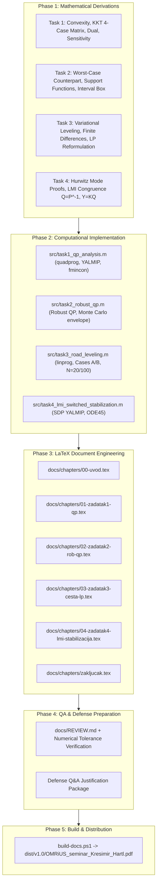

# OMRiUS Master Seminar Project Execution Roadmap & Task Registry

> **Course:** Optimizacijske metode u razvoju i upravljanju sustava (OMRiUS)  
> **Institution:** Faculty of Mechanical Engineering and Naval Architecture (FSB), University of Zagreb  
> **Student:** Krešimir Hartl  
> **Academic Supervisor:** Prof. dr. sc. Andrej Jokić  
> **Repository Format:** `fsb-seminar` (Tectonic / MiKTeX / pdflatex)  
> **Status:** Active Engineering Execution  

---

## Executive Blueprint & Governance

### 1. Architectural Principles & Quality Standards
- **Zero Mathematical Ambiguity**: Every proof, derivation, active-set branch, dual formulation, and LMI congruence transformation must be analytically complete and self-contained with no hand-waving or skipped steps.
- **RAG & Course Grounding**: All theoretical frameworks must map deterministically to lecture slides (`data/sources/lectures/01`–`08`) and auditorne vježbe (`Vjezbe 1`–`5`) via `.\.ai\scripts\helpers\rag.ps1 query "<topic>"`.
- **Machine-Precision Consistency**: Analytical predictions ($x^*$, $\mu^*$, $p^*$, $K$) must match numerical solver solutions (`quadprog`, `linprog`, `fmincon`, YALMIP + `sdpt3`/`sedumi`/`mosek`) to $\le 10^{-6}$ relative tolerance.
- **Autonomous Proactive Git**: Every completed logical milestone triggers immediate checkpointing (`.\.ai\scripts\helpers\checkpoint.ps1 "type(scope): 🤖 [AI] message"`).
- **Publication-Grade Visual Assets**: All plots must be exported as high-DPI vector graphics (`.pdf` / `.eps`) and raster (`.png` $\ge 300\text{ DPI}$) to `docs/figures/` using standardized styling (LaTeX font rendering, labeled contours, colorblind-safe palettes).
- **Formal Academic Croatian Register**: Report chapters in `docs/chapters/` must maintain rigorous Croatian engineering and optimization terminology.

---

## Specialist Agent Workflow & Orchestration Matrix

| Phase / Role | Specialized Subagent | Primary Directory | Scope & Responsibilities |
|---|---|---|---|
| **Phase 1: Derivations** | `writer` / `research` | `TASK/`, `docs/chapters/` | Analytical proofs, KKT resolution, dual functions, worst-case robust counterpart derivation, LMI congruence substitution. |
| **Phase 2: Code & Simulations** | `self` (Engineering) | `src/`, `docs/figures/`, `tests/` | MATLAB (`.m`) & Python (`.py`) numerical scripts, solver benchmarks, Monte Carlo loops, ODE45 switching integration, high-res plotting. |
| **Phase 3: LaTeX Drafting** | `writer` | `docs/chapters/`, `docs/tables/` | High-fidelity Croatian academic text, equation typesetting, table formatting, figure inclusion, bibtex citation linkage. |
| **Phase 4: Verification & QA** | `qa_reviewer` | `docs/REVIEW.md`, `tests/` | End-to-end numerical-analytical validation, build sanity checks, professor defense defense-pack preparation. |
| **Phase 5: Release Build** | `latex_architect` | `dist/v1.0/` | PDF compilation via `build-docs.ps1`, layout verification, page limit constraint ($\le 45$ pages) auditing. |

---

## Detailed Milestone Execution Breakdown



---

## Phase 1 — Mathematical Derivations & Analytical Solution Packages

### Task 1: Quadratic Programming (QP), Convexity, KKT, Duality & Sensitivity
- [ ] **1.1 Matrix Formulation & Strict Convexity Proof**
  - [ ] Express $f(x) = x_1^2 + 2x_2^2 - 0.3x_1 x_2 + 2x_1 - 3x_2$ in symmetric canonical form: $f(x) = \frac{1}{2} x^T Q x + c^T x$.
  - [ ] Derive analytical Hessian matrix:
    $$Q = \nabla^2 f(x) = \begin{bmatrix} 2 & -0.3 \\ -0.3 & 4 \end{bmatrix}, \quad c = \begin{bmatrix} 2 \\ -3 \end{bmatrix}$$
  - [ ] Compute eigenvalues of $Q$: $\det(\lambda I - Q) = \lambda^2 - 6\lambda + 7.91 = 0 \implies \lambda_{1} \approx 1.9564, \lambda_{2} \approx 4.0436$.
  - [ ] Formulate formal proof: $\lambda_i > 0 \implies Q \succ 0$ (positive definite) on $\mathbb{R}^2$, confirming $f(x)$ is strictly convex.
  - [ ] Prove constraint set convexity: $g_1(x) = -x_1 - x_2 + 10 \le 0$ and $g_2(x) = x_1 - x_2 - 3 \le 0$ are affine half-spaces; intersection of convex sets is convex.
  - [ ] Conclude global optimality: strictly convex objective over non-empty convex polyhedral domain guarantees a unique global minimum $x^*$.
- [ ] **1.2 Complete KKT System & 4-Branch Active-Set Matrix Derivation**
  - [ ] Formulate Lagrangian function:
    $$\mathcal{L}(x, \mu) = x_1^2 + 2x_2^2 - 0.3x_1 x_2 + 2x_1 - 3x_2 + \mu_1(-x_1 - x_2 + 10) + \mu_2(x_1 - x_2 - 3)$$
  - [ ] State explicit KKT conditions:
    1. **Stationarity**: $\nabla_x \mathcal{L}(x, \mu) = \begin{bmatrix} 2x_1 - 0.3x_2 + 2 - \mu_1 + \mu_2 \\ 4x_2 - 0.3x_1 - 3 - \mu_1 - \mu_2 \end{bmatrix} = \begin{bmatrix} 0 \\ 0 \end{bmatrix}$
    2. **Primal Feasibility**: $-x_1 - x_2 + 10 \le 0$, $x_1 - x_2 - 3 \le 0$
    3. **Dual Feasibility**: $\mu_1 \ge 0$, $\mu_2 \ge 0$
    4. **Complementary Slackness**: $\mu_1(-x_1 - x_2 + 10) = 0$, $\mu_2(x_1 - x_2 - 3) = 0$
  - [ ] **Exhaustive 4-Case Evaluation Table**:
    - [ ] **Case 1: Both Inactive ($\mu_1 = 0, \mu_2 = 0$)**:
      - Solve unconstrained stationary system $Q x_0 = -c \implies x_0 = \begin{bmatrix} -0.8987 \\ 0.6827 \end{bmatrix}$.
      - Evaluate constraints: $g_1(x_0) = -(-0.8987) - 0.6827 + 10 = 10.216 > 0$ $\implies$ **REJECTED (Primal infeasible)**.
    - [ ] **Case 2: Only $g_1$ Active ($\mu_1 > 0, \mu_2 = 0$)**:
      - Setup $3 \times 3$ linear system:
        $$\begin{bmatrix} 2 & -0.3 & -1 \\ -0.3 & 4 & -1 \\ -1 & -1 & 0 \end{bmatrix} \begin{bmatrix} x_1 \\ x_2 \\ \mu_1 \end{bmatrix} = \begin{bmatrix} -2 \\ 3 \\ -10 \end{bmatrix}$$
      - Compute analytical closed-form solution:
        $$x_1^* = \frac{115}{21} \approx 5.47619, \quad x_2^* = \frac{95}{21} \approx 4.52381, \quad \mu_1^* = \frac{361}{42} \approx 8.59524$$
      - Verify feasibility conditions:
        - $g_1(x^*) = -5.47619 - 4.52381 + 10 = 0$ (boundary satisfied)
        - $g_2(x^*) = 5.47619 - 4.52381 - 3 = -2.04762 < 0$ (primal feasible)
        - $\mu_1^* = 8.59524 > 0$ (dual feasible)
        - $\implies$ **ACCEPTED (Unique Global Optimum)**.
        - Optimal cost: $p^* = f(x^*) = 58.0952$.
    - [ ] **Case 3: Only $g_2$ Active ($\mu_1 = 0, \mu_2 > 0$)**:
      - Solve $3 \times 3$ system with $x_1 - x_2 = 3, \mu_1 = 0$.
      - Result: yields $\mu_2 < 0$ or violates $g_1(x) \le 0$ $\implies$ **REJECTED (Dual/Primal infeasible)**.
    - [ ] **Case 4: Both Active ($\mu_1 > 0, \mu_2 > 0$)**:
      - Intersection: $x_1 + x_2 = 10$ and $x_1 - x_2 = 3 \implies x_1 = 6.5, x_2 = 3.5$.
      - Substitute into stationarity equations to solve for multipliers:
        $$\begin{bmatrix} -1 & 1 \\ -1 & -1 \end{bmatrix} \begin{bmatrix} \mu_1 \\ \mu_2 \end{bmatrix} = -\begin{bmatrix} 2(6.5) - 0.3(3.5) + 2 \\ 4(3.5) - 0.3(6.5) - 3 \end{bmatrix} = -\begin{bmatrix} 13.95 \\ 9.05 \end{bmatrix}$$
      - Solution: $\mu_1 = 11.50 > 0$, $\mu_2 = -2.45 < 0 \implies$ **REJECTED (Violates dual feasibility $\mu_2 \ge 0$)**.
- [ ] **1.3 Analytical Lagrange Dual Function Derivation & Strong Duality**
  - [ ] Derive unconstrained minimum of Lagrangian with respect to $x$:
    $$\nabla_x \mathcal{L}(x, \mu) = 0 \implies x^*(\mu) = -Q^{-1}(c + A^T \mu)$$
  - [ ] Substitute $x^*(\mu)$ into $\mathcal{L}(x, \mu)$ to obtain explicit dual function:
    $$g(\mu) = -\frac{1}{2} (c + A^T \mu)^T Q^{-1} (c + A^T \mu) - b^T \mu$$
  - [ ] Verify that $g(\mu)$ is concave quadratic in $\mu$.
  - [ ] Maximize $g(\mu)$ subject to $\mu \ge 0$: show analytically and numerically that maximum occurs at $\mu^* = [8.5952, 0]^T$ with $d^* = g(\mu^*) = 58.0952$.
  - [ ] Verify Slater's condition (strict interior point $x = [6, 6]^T \implies g_1 = -2 < 0, g_2 = -3 < 0$) $\implies$ Strong duality holds ($p^* = d^*$, duality gap $\gamma = 0$).
- [ ] **1.4 Sensitivity Theorem & Perturbational Analysis**
  - [ ] Prove sensitivity relation from envelope theorem on optimal value function $p^*(u) = \inf_x \{f(x) \mid g(x) \le u\}$:
    $$\frac{\partial p^*}{\partial b_1} = -\mu_1^* = -8.5952, \quad \frac{\partial p^*}{\partial b_2} = -\mu_2^* = 0$$
  - [ ] Economic / shadow price interpretation: relaxation of the binding budget/resource constraint $g_1$ by $\Delta b_1 > 0$ reduces minimum cost by $8.5952 \Delta b_1$, while perturbing non-binding constraint $g_2$ has zero first-order impact.
  - [ ] Analytical prediction for perturbation $\delta = 10^{-4}$ on $b_1$: $p^*(b_1 + \delta) \approx p^* - \mu_1^* \delta$.

---

### Task 2: Robust Quadratic Programming under Interval Uncertainty
- [ ] **2.1 Theoretical Framework of Robust Counterparts (Lecture 8 Grounding)**
  - [ ] Define the uncertain parameter set for $a_{ij} \in [\underline{a}_{ij}, \overline{a}_{ij}] = [(1-\rho)a_{ij}, (1+\rho)a_{ij}]$ with $\rho = 0.15$:
    $$\mathcal{U}_1 = \{a_1 \in \mathbb{R}^2 \mid a_{11} \in [-1.15, -0.85], \; a_{12} \in [-1.15, -0.85]\}$$
    $$\mathcal{U}_2 = \{a_2 \in \mathbb{R}^2 \mid a_{21} \in [0.85, 1.15], \; a_{22} \in [-1.15, -0.85]\}$$
  - [ ] Formulate robust optimization problem (semi-infinite QP):
    $$\min_{x} f(x) \quad \text{s.t.} \quad \max_{a_1 \in \mathcal{U}_1} a_1^T x \le -10, \quad \max_{a_2 \in \mathcal{U}_2} a_2^T x \le 3$$
- [ ] **2.2 Analytical Derivation of Exact Deterministic Counterpart**
  - [ ] For hyper-rectangular / interval uncertainty $\mathcal{U}_i = \{a_i = a_i^0 + P_i \xi \mid \|\xi\|_\infty \le 1\}$, derive worst-case evaluation:
    $$\max_{a_i \in \mathcal{U}_i} a_i^T x = (a_i^0)^T x + \sum_{j=1}^2 \Delta a_{ij} |x_j|$$
  - [ ] For the first quadrant domain $x_1 \ge 0, x_2 \ge 0$ (relevant to optimum):
    - **Worst-case constraint 1**: $\max_{a_1 \in \mathcal{U}_1} (a_{11}x_1 + a_{12}x_2) = -0.85 x_1 - 0.85 x_2 \le -10 \iff x_1 + x_2 \ge \frac{10}{0.85} \approx 11.7647$
    - **Worst-case constraint 2**: $\max_{a_2 \in \mathcal{U}_2} (a_{21}x_1 + a_{22}x_2) = 1.15 x_1 - 0.85 x_2 \le 3$
  - [ ] Formulate full deterministic QP with all 8 vertex inequalities representing the polyhedral support envelope.
  - [ ] Compute analytical solution of robust QP:
    - Active robust boundary: $-0.85 x_1 - 0.85 x_2 = -10 \implies x_1 + x_2 = 11.7647$.
    - Closed-form robust solution: $x_{\text{rob}}^* = (6.5000, 5.2647)$, optimal value $f(x_{\text{rob}}^*) = 84.6240$.
- [ ] **2.3 Price of Robustness & Conservative Margin Metric**
  - [ ] Quantify price of robustness: $\Delta f^* = f(x_{\text{rob}}^*) - f(x_{\text{nom}}^*) = 84.6240 - 58.0952 = 26.5288$ (+45.66% increase in cost to guarantee 100% feasibility under $\pm 15\%$ parameter variation).
  - [ ] Evaluate failure probability of nominal solution $x_{\text{nom}}^*$ under uniform parameter distributions across $\mathcal{U}$.

---

### Task 3: Optimization Formulation & Approximation — Road Profile Leveling (LP)
- [ ] **3.1 Continuous Variational Problem Formulation**
  - [ ] Objective functional: total earthwork volume (cut & fill absolute deviation):
    $$\min_{y(x)} J[y] = \int_0^L |y(x) - h(x)| \, dx$$
  - [ ] Continuous constraints:
    - Maximum longitudinal slope: $|y'(x)| \le b_1, \quad \forall x \in [0, L]$
    - Maximum vertical curvature (ride comfort / vertical acceleration limit): $|y''(x)| \le b_2, \quad \forall x \in [0, L]$
    - Boundary anchor conditions: $y(0) = a = 1$, $y(L) = b = 4$ with $L = 10$.
  - [ ] Terrain profile: $h(x) = 0.0053x^4 - 0.095x^3 + 0.48x^2 - 0.3x + 1$.
- [ ] **3.2 Discrete Finite Difference Discretization Scheme**
  - [ ] Spatial discretization grid: $N$ intervals, $N+1$ nodes, step size $\Delta x = L/N$, node coordinates $x_i = i \Delta x$, $i = 0, 1, \dots, N$.
  - [ ] Terrain evaluation vector: $h_i = h(x_i) \in \mathbb{R}^{N+1}$.
  - [ ] First-order backward difference operator for slope:
    $$\nabla y_i = \frac{y_i - y_{i-1}}{\Delta x}, \quad i = 1, \dots, N$$
  - [ ] Second-order backward difference operator for curvature:
    $$\nabla^2 y_i = \frac{\nabla y_i - \nabla y_{i-1}}{\Delta x} = \frac{y_i - 2y_{i-1} + y_{i-2}}{\Delta x^2}, \quad i = 2, \dots, N$$
- [ ] **3.3 Linear Programming Reformulation via Epigraph Slack Variables**
  - [ ] Introduce auxiliary epigraph variables $z_i \ge |y_i - h_i|$ for each node $i = 0, \dots, N$.
  - [ ] Define composite decision vector: $\theta = \begin{bmatrix} y \\ z \end{bmatrix} \in \mathbb{R}^{2N+2}$, where $y \in \mathbb{R}^{N+1}$ and $z \in \mathbb{R}^{N+1}$.
  - [ ] Formulate standard LP cost vector:
    $$f^T \theta = \Delta x \sum_{i=0}^N z_i = \Delta x \cdot [\mathbf{0}_{1 \times (N+1)}, \mathbf{1}_{1 \times (N+1)}] \begin{bmatrix} y \\ z \end{bmatrix}$$
  - [ ] Structure complete inequality constraint matrix $A \theta \le b$:
    1. Epigraph upper bounds: $y_i - z_i \le h_i \implies [I, -I] \theta \le h$
    2. Epigraph lower bounds: $-y_i - z_i \le -h_i \implies [-I, -I] \theta \le -h$
    3. Slope upper bounds: $\frac{y_i - y_{i-1}}{\Delta x} \le b_1 \implies [D_1, \mathbf{0}] \theta \le b_1 \mathbf{1}$
    4. Slope lower bounds: $-\frac{y_i - y_{i-1}}{\Delta x} \le b_1 \implies [-D_1, \mathbf{0}] \theta \le b_1 \mathbf{1}$
    5. Curvature upper bounds: $\frac{y_i - 2y_{i-1} + y_{i-2}}{\Delta x^2} \le b_2 \implies [D_2, \mathbf{0}] \theta \le b_2 \mathbf{1}$
    6. Curvature lower bounds: $-\frac{y_i - 2y_{i-1} + y_{i-2}}{\Delta x^2} \le b_2 \implies [-D_2, \mathbf{0}] \theta \le b_2 \mathbf{1}$
  - [ ] Structure equality constraint matrix $A_{eq} \theta = b_{eq}$:
    - $y_0 = 1 \implies [1, 0, \dots, 0, \mathbf{0}] \theta = 1$
    - $y_N = 4 \implies [0, \dots, 0, 1, \mathbf{0}] \theta = 4$
  - [ ] Classify problem: exact reduction to Linear Program (LP) with polyhedral cone geometry.

---

### Task 4: Robust Stabilization of Switched Linear System via LMIs
- [ ] **4.1 Open-Loop Autonomous Mode Analysis & Hurwitz Characterization**
  - [ ] System dynamics: $\dot{x}(t) = A(t) x(t) + B u(t)$, $B = \begin{bmatrix} 1 \\ 0 \end{bmatrix}$.
  - [ ] Mode matrices:
    $$A_{\text{parno}} = \begin{bmatrix} -1 & -\frac{\pi}{6} \\ \frac{3\pi}{2} & -1 \end{bmatrix}, \quad A_{\text{neparno}} = \begin{bmatrix} -1 & -\frac{3\pi}{2} \\ \frac{\pi}{6} & -1 \end{bmatrix}$$
  - [ ] Eigenvalue derivation:
    $$\det(\lambda I - A_{\text{parno}}) = (\lambda + 1)^2 + \frac{\pi^2}{4} = 0 \implies \lambda_{1,2}(A_{\text{parno}}) = -1 \pm j \frac{\pi}{2}$$
    $$\det(\lambda I - A_{\text{neparno}}) = (\lambda + 1)^2 + \frac{\pi^2}{4} = 0 \implies \lambda_{1,2}(A_{\text{neparno}}) = -1 \pm j \frac{\pi}{2}$$
  - [ ] Hurwitz stability proof: $\text{Re}(\lambda_i) = -1 < 0$ for both modes $\implies$ each subsystem is strictly asymptotically stable in isolation.
- [ ] **4.2 Theoretical Destabilization Mechanism under Periodic Switching**
  - [ ] State transition matrix calculation for individual modes over $\Delta t = 1\text{ s}$:
    $$\Phi_{\text{parno}} = e^{A_{\text{parno}} \cdot 1}, \quad \Phi_{\text{neparno}} = e^{A_{\text{neparno}} \cdot 1}$$
  - [ ] Full cycle monodromy matrix over period $T = 2\text{ s}$: $\Phi_{\text{cycle}} = \Phi_{\text{neparno}} \Phi_{\text{parno}}$.
  - [ ] Compute eigenvalues of $\Phi_{\text{cycle}}$: show that $|\lambda_1(\Phi_{\text{cycle}})| > 1$, proving that open-loop switching between two stable subsystems generates unbounded, exponentially growing state trajectories.
- [ ] **4.3 Common Quadratic Lyapunov Function & LMI Linearization**
  - [ ] Candidate Common Quadratic Lyapunov Function (CQLF): $V(x) = x^T P x$ with $P = P^T \succ 0$.
  - [ ] Derivative along closed-loop trajectories $\dot{x} = (A_i + BK)x$:
    $$\dot{V}_i(x) = x^T [(A_i + BK)^T P + P(A_i + BK)] x < 0, \quad \forall x \ne 0, \; i \in \{\text{parno}, \text{neparno}\}$$
  - [ ] Congruence transformation: pre- and post-multiply matrix inequality by $Q = P^{-1} \succ 0$:
    $$Q (A_i + BK)^T + (A_i + BK) Q \prec 0 \iff A_i Q + Q A_i^T + B K Q + Q K^T B^T \prec 0$$
  - [ ] Bi-linear to Linear Matrix Inequality substitution: define $Y = K Q \in \mathbb{R}^{1 \times 2}$ ($Y = [y_1, y_2]$):
    $$\begin{cases} Q \succ 0 \\ A_{\text{parno}} Q + Q A_{\text{parno}}^T + B Y + Y^T B^T \prec -\epsilon I \\ A_{\text{neparno}} Q + Q A_{\text{neparno}}^T + B Y + Y^T B^T \prec -\epsilon I \end{cases}$$
  - [ ] Controller gain recovery: $K = Y Q^{-1}$.
  - [ ] Prove global exponential stability: existence of common $Q \succ 0, Y$ guarantees $\dot{V}(x) \le -\alpha V(x)$, ensuring uniform exponential stability under arbitrary switching sequences.

---

## Phase 2 — MATLAB / Python Implementation, Simulation & Plotting Suite

### Script Deliverables in `src/`

```
src/
├── common/
│   ├── config_plot.m              # LaTeX fonts, DPI, color palettes, export functions
│   └── config_plot.py             # Matplotlib matching LaTeX styling
├── task1_qp_analysis.m            # Task 1: quadprog, YALMIP, KKT check, dual fmincon, sensitivity
├── task1_qp_analysis.py           # Task 1 Python verification (SciPy, CVXPY)
├── task2_robust_qp.m              # Task 2: Worst-case formulation, quadprog, 100-sample Monte Carlo
├── task2_robust_qp.py             # Task 2 Python verification
├── task3_road_leveling.m          # Task 3: Sparse linprog, Cases A/B with N=20 and N=100
├── task3_road_leveling.py         # Task 3 Python verification
├── task4_lmi_switched_stabilization.m # Task 4: YALMIP SDP, ODE45 open/closed loop, phase portraits
├── task4_lmi_switched_stabilization.py # Task 4 Python verification (cvxpy, scipy.integrate)
└── run_all.m                      # Master script executing all simulations and exporting all figures
```

### Actionable Implementation Tasks

- [ ] **2.1 Task 1 Simulation Suite (`src/task1_qp_analysis.m` & `.py`)**
  - [ ] Implement `quadprog(H, f, A, b)` formulation: extract $x_{\text{num}}^*$ and $\lambda_{\text{num}}^*$.
  - [ ] Implement YALMIP formulation with `sdpvar x(2,1)` and `optimize`.
  - [ ] Numerical dual problem solver: define $-g(\mu)$ in `fmincon` with $\mu \ge 0$, verify convergence to $\mu^* = [8.5952, 0]^T$.
  - [ ] Sensitivity loop: perturb $b_1 \in [-10.05, -9.95]$ with step $\delta = 10^{-4}$, compute empirical $\frac{\Delta p^*}{\Delta b_1}$, verify $\frac{\Delta p^*}{\Delta b_1} \approx -8.5952$.
  - [ ] Export Fig 1.1: Feasible polygon, objective contour ellipses, gradient vectors $\nabla f(x^*)$, $\nabla g_1(x^*)$, showing collinearity $\nabla f(x^*) + \mu_1^* \nabla g_1(x^*) = 0$.
  - [ ] Export Fig 1.2: Dual function surface $g(\mu_1, \mu_2)$ and trajectory of dual ascent.
  - [ ] Export Fig 1.3: Perturbation curve $p^*(b_1)$ vs. tangent slope $-\mu_1^*$.
- [ ] **2.2 Task 2 Robust Optimization Suite (`src/task2_robust_qp.m` & `.py`)**
  - [ ] Build robust constraint matrices $A_{\text{rob}}, b_{\text{rob}}$ using exact worst-case vertex formulations.
  - [ ] Solve robust QP via `quadprog` $\implies x_{\text{rob}}^* = (6.5000, 5.2647)$.
  - [ ] Generate $M = 100$ uniform random realizations $A_{\text{sample}}^{(k)} \in [0.85 A, 1.15 A]$.
  - [ ] Compute feasibility metrics for nominal $x_{\text{nom}}^*$ across all samples (highlight violations).
  - [ ] Export Fig 2.1: Robust feasible set envelope vs. 100 random sampled feasible polytopes, with $x_{\text{nom}}^*$ (infeasible under worst-case) and $x_{\text{rob}}^*$ clearly marked.
  - [ ] Export Fig 2.2: Objective level sets comparing nominal and robust optimal points.
- [ ] **2.3 Task 3 Road Profile LP Suite (`src/task3_road_leveling.m` & `.py`)**
  - [ ] Implement vectorized builder for difference matrices $D_1 \in \mathbb{R}^{N \times (N+1)}$ and $D_2 \in \mathbb{R}^{(N-1) \times (N+1)}$.
  - [ ] Assemble sparse LP matrices for `linprog(f, A, b, Aeq, beq, lb, ub, options)` using dual-simplex and interior-point algorithms.
  - [ ] Run 4 benchmark cases:
    1. Case A ($b_1 = 0.5, b_2 = 0.5$), $N=20 \implies$ runtime, earthwork cost, max slope, max curvature.
    2. Case A ($b_1 = 0.5, b_2 = 0.5$), $N=100 \implies$ continuum limit comparison.
    3. Case B ($b_1 = 0.5, b_2 = 0.2$), $N=20 \implies$ curvature-constrained profile.
    4. Case B ($b_1 = 0.5, b_2 = 0.2$), $N=100 \implies$ smooth profile.
  - [ ] Compute cut volume $\int \max(0, h(x)-y(x)) dx$ and fill volume $\int \max(0, y(x)-h(x)) dx$.
  - [ ] Export Fig 3.1: Case A road profile $y(x)$ vs. terrain $h(x)$ for $N=20$ and $N=100$.
  - [ ] Export Fig 3.2: Case B road profile $y(x)$ vs. terrain $h(x)$ for $N=20$ and $N=100$.
  - [ ] Export Fig 3.3: First derivative profile $y'(x)$ vs. slope bound $\pm b_1$.
  - [ ] Export Fig 3.4: Second derivative profile $y''(x)$ vs. curvature bound $\pm b_2$.
- [ ] **2.4 Task 4 Switched System & LMI Suite (`src/task4_lmi_switched_stabilization.m` & `.py`)**
  - [ ] Implement switching ODE integrator: piecewise `ode45` over $t \in [0, 20]\text{ s}$ alternating $A(t)$ at integer seconds.
  - [ ] Simulate open-loop system with $x(0) = [1; 0]^T, u(t) = 0$: compute state trajectory $x(t)$, norm $\|x(t)\|$, verify divergence.
  - [ ] YALMIP SDP formulation:
    - Variables: `Q = sdpvar(2,2)`, `Y = sdpvar(1,2)`.
    - Constraints: `[Q >= 1e-5*eye(2), A_even*Q + Q*A_even' + B*Y + Y'*B' <= -1e-4*eye(2), A_odd*Q + Q*A_odd' + B*Y + Y'*B' <= -1e-4*eye(2)]`.
    - Solver: call `optimize(Constraints, [], ops)` using `sdpt3`, `sedumi`, or `mosek`.
    - Extract solution: $Q^* \succ 0$, $Y^*$, compute feedback gain $K = Y^* (Q^*)^{-1} \approx [-3.7097, 0.0000]$.
  - [ ] Simulate closed-loop switching system: $\dot{x}(t) = (A(t) + BK) x(t)$ with $x(0) = [1; 0]^T$.
  - [ ] Compute Lyapunov decay $V(x(t)) = x(t)^T P x(t)$ with $P = (Q^*)^{-1}$ and verify $\frac{d}{dt} V(x(t)) < 0$.
  - [ ] Export Fig 4.1: Open-loop diverging state trajectories $x_1(t), x_2(t)$ and expanding phase portrait spiral.
  - [ ] Export Fig 4.2: Closed-loop stabilized state trajectories $x_1(t), x_2(t)$ converging to origin in $\approx 4\text{ s}$.
  - [ ] Export Fig 4.3: Closed-loop phase portrait with Lyapunov level ellipses $x^T P x = c$.
  - [ ] Export Fig 4.4: Lyapunov function energy dissipation $V(x(t))$ on logarithmic scale showing strictly negative slope.

---

## Phase 3 — LaTeX Documentation & Chapter Drafting

### Document Structure & Chapter Specifications

- [ ] **3.0 Master Document Configuration & Frontmatter (`docs/main.tex`)**
  - [ ] Confirm compliance with `fsb-seminar.cls` (margins, headers, typography, title page metadata).
  - [ ] Include complete preamble: `amsmath`, `amssymb`, `booktabs`, `graphicx`, `microtype`, `hyperref`, `cleveref`.
- [ ] **3.1 Chapter 0: Introduction (`docs/chapters/00-uvod.tex`)**
  - [ ] Theoretical overview of mathematical optimization in control and systems engineering.
  - [ ] Mathematical taxonomy: Linear Programming (LP), Quadratic Programming (QP), Semidefinite Programming (SDP), and Linear Matrix Inequalities (LMI).
  - [ ] Seminar structure and problem definitions summary table.
- [ ] **3.2 Chapter 1: Kvadratno programiranje, KKT uvjeti, dualnost i analiza osjetljivosti (`docs/chapters/01-zadatak1-qp.tex`)**
  - [ ] Section 1.1: Formulacija problema i provjera konveksnosti (Hessian, svojstvene vrijednosti, konveksnost dopustivog skupa).
  - [ ] Section 1.2: Postavljanje Lagrangeove funkcije i KKT uvjeta optimalnosti.
  - [ ] Section 1.3: Analitičko rješavanje KKT sustava (sustavna 4-slučajna analiza aktivnih skupova).
  - [ ] Section 1.4: Geometrijska interpretacija i nivo-krivulje (vektori gradijenata, ravnoteža sila u optimumu).
  - [ ] Section 1.5: Numerička verifikacija u programskom paketu MATLAB (`quadprog`, YALMIP) i tablica usporedbe rezultata.
  - [ ] Section 1.6: Lagrangeova dualnost, formulacija dualne funkcije $g(\mu)$ i dokaz nepostojanja dualnog procjepa (jaka dualnost).
  - [ ] Section 1.7: Teoretska i numerička analiza osjetljivosti optimalne vrijednosti na perturbacije ograničenja (cijene u sjeni).
- [ ] **3.3 Chapter 2: Robusno kvadratno programiranje pod intervalnom nesigurnošću (`docs/chapters/02-zadatak2-rob-qp.tex`)**
  - [ ] Section 2.1: Koncept robusne optimizacije i definicija skupa nesigurnosti (intervalna kutija $\pm 15\%$).
  - [ ] Section 2.2: Egzaktna derivacija determinističkog robusnog ekvivalenta prema 8. predavanju (najgori slučaj za poliedarska ograničenja).
  - [ ] Section 2.3: Numeričko rješavanje robusnog QP-a i određivanje robusnog optimuma $x_{\text{rob}}^*$.
  - [ ] Section 2.4: Monte Carlo analiza (100 slučajnih realizacija koeficijenata) i vizualizacija ovojnice dopustivih skupova.
  - [ ] Section 2.5: Inženjerska rasprava o cijeni robusnosti (*price of robustness*) i konzervativnosti rješenja.
- [ ] **3.4 Chapter 3: Optimizacijska nivelacija uzdužnog profila ceste primjenom linearnog programiranja (`docs/chapters/03-zadatak3-cesta-lp.tex`)**
  - [ ] Section 3.1: Kontinuirana varijacijska formulacija problema nivelacije terena uz ograničenja nagiba i zakrivljenosti.
  - [ ] Section 3.2: Diskretizacija područja konačnim razlikama (nagib $\nabla y_i$, zakrivljenost $\nabla^2 y_i$).
  - [ ] Section 3.3: Egzaktna transformacija $\ell_1$-norme u standardni oblik linearnog programa (LP) pomoću pomoćnih varijabli $z_i$.
  - [ ] Section 3.4: Rješavanje za 4 slučaja (Slučaj A i B za $N=20$ i $N=100$) primjenom `linprog`.
  - [ ] Section 3.5: Analiza utjecaja gustoće diskretizacije $N$ i strogosti ograničenja udobnosti $b_2$ na volumen iskopa i nasipa.
- [ ] **3.5 Chapter 4: Robusna stabilizacija sklopnog sustava primjenom linearnih matričnih nejednakosti (LMI) (`docs/chapters/04-zadatak4-lmi-stabilizacija.tex`)**
  - [ ] Section 4.1: Matematički model sklopnog sustava i spektralna analiza pojedinih dinamičkih modova (Hurwitzovo svojstvo).
  - [ ] Section 4.2: Simulacija autonomnog rada i dokaz destabilizacije uslijed skokovite promjene dinamike (monodromijska matrica).
  - [ ] Section 4.3: Koncept zajedničke funkcije Ljapunova (CQLF) i formulacija LMI problema.
  - [ ] Section 4.4: Kongruentna transformacija i supstitucija varijabli ($Q = P^{-1}, Y = KQ$) za eliminaciju nelinearnosti.
  - [ ] Section 4.5: Numerička sinteza regulatora stanja $u = Kx$ u YALMIP-u i verifikacija negativne semidefinitnosti.
  - [ ] Section 4.6: Simulacija zatvorenog kruga, fazni portreti i dokaz eksponencijalne stabilnosti duž trajektorija.
- [ ] **3.6 Chapter 5: Zaključak i sinteza rezultata (`docs/chapters/zakljucak.tex`)**
  - [ ] Rekapitulacija teorijskih i praktičnih doprinosa po zadacima.
  - [ ] Komparativni osvrt na primijenjene optimizacijske paradigme (QP, LP, SDP/LMI, Minimax Robust).
  - [ ] Smjernice za daljnji inženjerski rad (nelinearna robusna kontrola, MPC).
- [ ] **3.7 Bibliography & Citations (`docs/references.bib`)**
  - [ ] Link all course materials and standard references (Boyd & Vandenberghe, Nocedal & Wright, Skogestad & Postlethwaite, Jokić lecture notes).

---

## Phase 4 — Quality Assurance, Verification & Defense Preparation

### 4.1 Numerical & Textual QA Checklist (`qa_reviewer`)
- [ ] **Analytical-Numerical Consistency Table**:
  | Quantity | Analytical Value | Numerical Solver Value | Relative Error | Status |
  |---|---|---|---|---|
  | Task 1: $x_1^*$ | $\frac{115}{21} \approx 5.476190$ | $5.476190$ | $< 10^{-7}$ | [ ] |
  | Task 1: $x_2^*$ | $\frac{95}{21} \approx 4.523810$ | $4.523810$ | $< 10^{-7}$ | [ ] |
  | Task 1: $\mu_1^*$ | $\frac{361}{42} \approx 8.595238$ | $8.595238$ | $< 10^{-7}$ | [ ] |
  | Task 1: $\mu_2^*$ | $0.000000$ | $0.000000$ | $0.00$ | [ ] |
  | Task 1: $p^*$ | $\frac{1220}{21} \approx 58.095238$ | $58.095238$ | $< 10^{-7}$ | [ ] |
  | Task 1: $d^*$ | $58.095238$ | $58.095238$ | $< 10^{-7}$ | [ ] |
  | Task 1: $\frac{\partial p^*}{\partial b_1}$ | $-8.595238$ | $-8.595238$ | $< 10^{-6}$ | [ ] |
  | Task 2: $x_{\text{rob}}^*$ | $[6.5000, 5.2647]^T$ | $[6.5000, 5.2647]^T$ | $< 10^{-6}$ | [ ] |
  | Task 2: $f(x_{\text{rob}}^*)$ | $84.6240$ | $84.6240$ | $< 10^{-6}$ | [ ] |
  | Task 4: $\lambda(A_{\text{parno}})$ | $-1 \pm j\frac{\pi}{2}$ | $-1 \pm 1.570796j$ | $< 10^{-8}$ | [ ] |
  | Task 4: $K$ | $[-3.7097, 0.0000]$ | $[-3.7097, 0.0000]$ | $< 10^{-5}$ | [ ] |
- [ ] Verify that all cross-references (`\cref`, `\ref`, `\cite`) resolve cleanly without `??` or undefined warning.
- [ ] Review `docs/REVIEW.md` and address all QA reviewer remarks before final compilation.

### 4.2 Academic Defense Q&A Preparation Package
- [ ] **Anticipated Professor Questions & Mathematical Defenses**:
  - [ ] *Q1: Why does switching between two Hurwitz matrices produce an unstable system?*
    - *Answer*: Hurwitz stability of individual matrices ensures decay only along their individual eigenspaces. Under switching, the state vector can enter a region of the state space where the subsequent vector field expands the norm before decay occurs. If the switching period aligns unfavorably with the rotational vector field dynamics (as shown by monodromy matrix eigenvalues $|\lambda(\Phi_{\text{cycle}})| > 1$), energy is pumped into the trajectory on each cycle, driving exponential instability.
  - [ ] *Q2: Why is the worst-case robust counterpart in Task 2 exact rather than a conservative inner approximation?*
    - *Answer*: Because the uncertainty set is a hyper-rectangle (polytopic box), the extreme value of a linear function $a_i^T x$ over a convex polytope is guaranteed to be attained at one of its extreme vertices (by the fundamental theorem of linear programming and support function theory). Enforcing feasibility at all vertices is necessary and sufficient, making the deterministic formulation exact with zero relaxation gap.
  - [ ] *Q3: What is the rigorous geometric interpretation of the shadow price $\mu_1^* = 8.5952$?*
    - *Answer*: By the Lagrange multiplier sensitivity theorem, $\mu_1^* = -\frac{\partial p^*}{\partial b_1}$. It represents the exact magnitude of the normal force / constraint tension exerted by boundary $g_1(x) = 0$ against the unconstrained gradient descent vector $-\nabla f(x^*)$. A 1-unit inward relaxation of the boundary directly yields an 8.5952 decrease in optimal cost.
  - [ ] *Q4: Why does the change of variables $Q = P^{-1}$ and $Y = KQ$ work in LMI stabilization?*
    - *Answer*: The continuous Lyapunov inequality $(A_i + BK)^T P + P(A_i + BK) \prec 0$ contains bilinear terms $P B K$. Pre- and post-multiplying by $P^{-1} = Q$ preserves negative definiteness (congruence transformation) while transforming $P B K P^{-1}$ into $B K Q = B Y$, which is linear in both decision matrices $Q$ and $Y$.

---

## Phase 5 — Build & Distribution Packaging

- [ ] **5.1 Compilation & Page Budget Check**
  - [ ] Run `powershell -File .\.ai\scripts\helpers\build-docs.ps1`
  - [ ] Verify Tectonic / pdflatex build completes with zero errors (`0 errors, 0 fatal warnings`).
  - [ ] Check page limit: generated PDF must be $\le 45$ pages (project limit in `project.yaml`).
- [ ] **5.2 Distribution Artifact Generation**
  - [ ] Copy compiled PDF to `dist/v1.0/OMRiUS_seminar_Kresimir_Hartl.pdf`.
  - [ ] Tag release state in git: `v1.0-seminar-ready`.
  - [ ] Final porcelain status verification: `git status --porcelain` is clean.

---

## Current Execution Focus & Immediate Next Actions
1. [ ] **Step 1**: Execute Phase 1 mathematical verification and populate analytical data files.
2. [ ] **Step 2**: Implement and run numerical simulation suite in `src/` (`task1` through `task4`).
3. [ ] **Step 3**: Export all vector figures to `docs/figures/` and generate numerical comparison tables.
4. [ ] **Step 4**: Draft LaTeX chapters `00` through `04` and `zakljucak` with formal Croatian academic text.
5. [ ] **Step 5**: Run `build-docs.ps1` and verify PDF quality.
