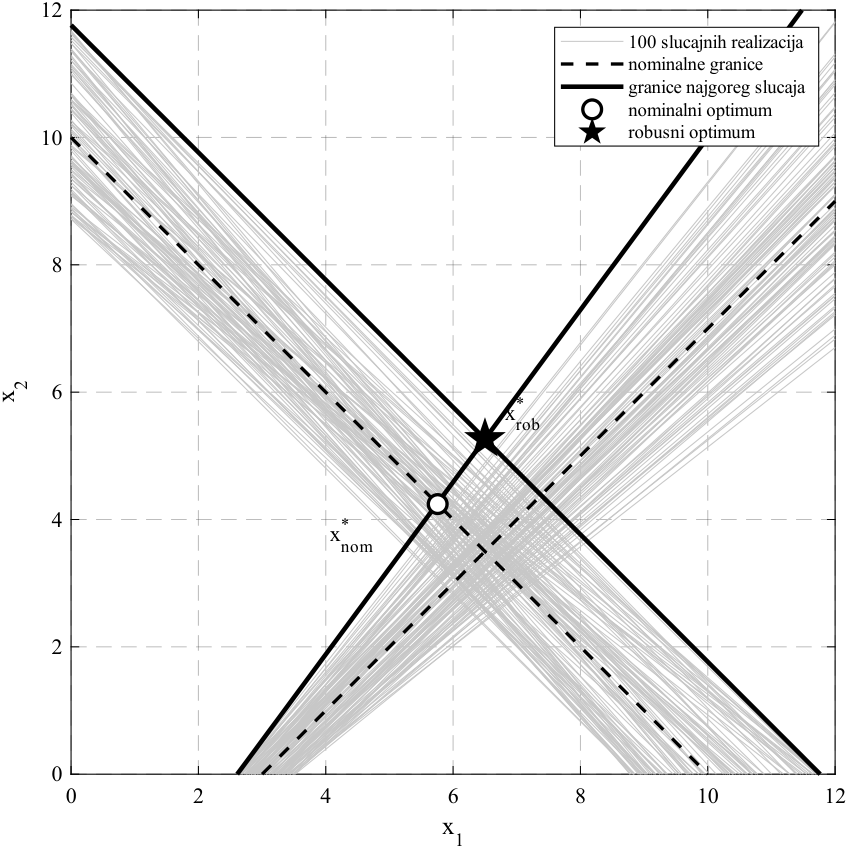

# POGLAVLJE 4: Robusno programiranje pod poliedarskom nesigurnošću

> **Sadržaj poglavlja:**  
> 4.1 Filozofija robusnosti: Deterministička vs. Worst-Case optimizacija  
> 4.2 Skup nesigurnosti u Zadatku 2: Poliedarska geometrija i intervalne varijacije  
> 4.3 Egzaktna ekvivalencija konveksne ljuske: Dokaz nepostojanja konzervatizma  
> 4.4 Rješavanje determinističkog robusnog QP-a s 8 nejednakosti  
> 4.5 Monte Carlo verifikacija (54/100 kršenja) i "Cijena robusnosti" (+39.63%)  
> 4.6 Povezivanje sa Slikom 3.1 seminara (`fig2_1_robust_envelope_monte_carlo.pdf`)  
> 4.7 Širi ispitni kontekst: Dualni pristup robusnosti i elipsoidne nesigurnosti (SOCP)  
> 4.8 Modul za pripremu usmene obrane: Ispitna pitanja, zamke i modelski odgovori  

---

## 4.1 Filozofija robusnosti: Deterministička vs. Worst-Case optimizacija

U klasičnom inženjerskom projektiranju često se pretpostavlja da su svi parametri modela poznati s apsolutnom točnošću (nominalni model). Međutim, u stvarnom inženjerskom svijetu nominalni model je fikcija (prof. Jokić, Predavanje 8):
- Mehaničke tolerancije pri izradi dijelova uzrokuju geometrijska odstupanja.
- Fizikalna svojstva materijala (modul elastičnosti, koeficijenti trenja, toplinska vodljivost) variraju s temperaturom i starenjem.
- Mjerenja senzora opterećena su šumom i nesigurnošću.

### Katastrofa nominalnog optimuma
Ako optimizaciju provedemo na nominalnom modelu, rješenje $x_{\mathrm{nom}}^*$ u pravilu završava **točno na samoj granici dopustivog skupa** (jer funkcija cilja "gura" točku dokle god može, tj. aktivira ograničenja).  
Kada takav projekt pustimo u stvarni rad, **i najmanja nepovoljna varijacija parametara pomaknut će granicu ograničenja preko točke $x_{\mathrm{nom}}^*$**, čime sustav postaje nedopustiv, što u inženjerstvu znači lom konstrukcije, termički preopterećen aktuator ili nestabilnost!

### Stohastički vs. Robusni pristup
Kako se boriti protiv nesigurnosti? Postoje dva glavna pristupa:
1. **Stohastičko programiranje:** Pretpostavlja se da su parametri slučajne varijable s *poznatom razdiobom vjerojatnosti* (npr. Gaussova razdioba). Minimizira se očekivani trošak ili se dopušta malo kršenje s malom vjerojatnošću (tzv. *chance constraints*).  
   *Ograničenje:* U inženjerskoj praksi točnu razdiobu vjerojatnosti gotovo nikada ne poznajemo, a optimizacija za "prosječni slučaj" može biti kobna za kritične sustave.
2. **Robusno optimiranje (Worst-Case pristup):** Ne pretpostavlja se nikakva razdioba vjerojatnosti. Jedino što znamo jest da se stvarni parametri nalaze unutar zadanog, kompaktnog **skupa nesigurnosti** $\mathcal{U}$.  
   Traži se rješenje koje mora biti dopustivo za **svaku moguću realizaciju** parametara unutar $\mathcal{U}$, uzimajući u obzir *najgori mogući scenarij* (*worst-case*).

---

## 4.2 Skup nesigurnosti u Zadatku 2: Poliedarska geometrija i intervalne varijacije

U Zadatku 2 seminara promatramo isti optimizacijski problem kao u Zadatku 1, ali s nesigurnim koeficijentima matrice ograničenja:
$$\min_{x \in \mathbb{R}^2} \quad f(x) = x_1^2 + 2x_2^2 - 0.3 x_1 x_2 + 2x_1 - 3x_2 \tag{4.1}$$
uz ograničenja:
$$a_1^{\mathsf{T}} x \leq h_1, \qquad a_2^{\mathsf{T}} x \leq h_2, \tag{4.2}$$
gdje su nominalne vrijednosti vektora bile:
$$a_1^0 = \begin{bmatrix} a_{11}^0 \\ a_{12}^0 \end{bmatrix} = \begin{bmatrix} -1 \\ -1 \end{bmatrix}, \quad h_1 = -10; \qquad a_2^0 = \begin{bmatrix} a_{21}^0 \\ a_{22}^0 \end{bmatrix} = \begin{bmatrix} 1 \\ -1 \end{bmatrix}, \quad h_2 = 3.$$

### Definicija intervala nesigurnosti ($\pm 15\%$)
Zadano je da se stvarna vrijednost svakog koeficijenta $a_{ij}$ nalazi u intervalu od $\pm 15\%$ oko nominalne vrijednosti:
$$a_{ij} \in [0.85 a_{ij}^0, \; 1.15 a_{ij}^0], \quad i \in \{1, 2\}, \; j \in \{1, 2\}. \tag{4.3}$$

Pažljivo izračunajmo intervale za svaki parametar:
- Za $a_{11}^0 = -1$: interval je $[-1.15, -0.85]$.
- Za $a_{12}^0 = -1$: interval je $[-1.15, -0.85]$.
- Za $a_{21}^0 = +1$: interval je $[+0.85, +1.15]$.
- Za $a_{22}^0 = -1$: interval je $[-1.15, -0.85]$.

Vektori redaka $a_1$ i $a_2$ stoga se nalaze u Kartezijevim produktima intervala, što geometrijski predstavlja **pravokutnike nesigurnosti** u prostoru parametara $\mathbb{R}^2$:
$$\mathcal{P}_1 = [-1.15, -0.85] \times [-1.15, -0.85] \subset \mathbb{R}^2, \tag{4.4a}$$
$$\mathcal{P}_2 = [0.85, 1.15] \times [-1.15, -0.85] \subset \mathbb{R}^2. \tag{4.4b}$$

### Formulacija robusnog pandana (Robust Counterpart)
Robusni problem zahtijeva da rješenje $x$ zadovoljava ograničenja za **sve** točke unutar pravokutnika nesigurnosti:
$$\begin{aligned}
\min_{x \in \mathbb{R}^2} \quad & \frac{1}{2} x^{\mathsf{T}} Q x + c^{\mathsf{T}} x \\
\text{uz} \quad & a_1^{\mathsf{T}} x \leq -10, \quad \forall a_1 \in \mathcal{P}_1, \\
& a_2^{\mathsf{T}} x \leq 3, \quad \forall a_2 \in \mathcal{P}_2.
\end{aligned} \tag{4.5}$$

Budući da skupovi $\mathcal{P}_1$ i $\mathcal{P}_2$ sadrže beskonačno mnogo točaka, relacije (4.5) predstavljaju problem s **beskonačno mnogo ograničenja** (tzv. *semi-infinite program*). Može se zapisati preko supremuma:
$$\sup_{a_1 \in \mathcal{P}_1} a_1^{\mathsf{T}} x \leq -10, \qquad \sup_{a_2 \in \mathcal{P}_2} a_2^{\mathsf{T}} x \leq 3. \tag{4.6}$$

---

## 4.3 Egzaktna ekvivalencija konveksne ljuske: Dokaz nepostojanja konzervatizma

Kako beskonačno mnogo ograničenja svesti na konačan broj jednadžbi s kojima računalo može raditi? Odgovor daje teorija konveksnih poliedara.

> **Teorem 4.1 (Ekvivalencija konveksne ljuske vrhova):**  
> Neka je $\mathcal{P} \subset \mathbb{R}^n$ konveksan politop definiran kao konveksna ljuska svojih $K$ vrhova:
> $$\mathcal{P} = \mathrm{co}\big(v^{(1)}, v^{(2)}, \dots, v^{(K)}\big) = \left\{ \sum_{k=1}^K \gamma_k v^{(k)} \;\middle|\; \gamma_k \geq 0, \; \sum_{k=1}^K \gamma_k = 1 \right\}.$$
> Tada je robusno ograničenje $\sup_{a \in \mathcal{P}} a^{\mathsf{T}} x \leq h$ **egzaktno ekvivalentno** sustavu od $K$ determinističkih linearnih nejednakosti:
> $$\sup_{a \in \mathcal{P}} a^{\mathsf{T}} x \leq h \iff (v^{(k)})^{\mathsf{T}} x \leq h, \quad \forall k \in \{1, \dots, K\}. \tag{4.7}$$

### Egzaktni matematički dokaz (u dva smjera):
Dokazujemo ekvivalenciju $\iff$, što jamči da nema nikakvog gubitka točnosti (nema relaksacijskog procjepa!):

1. **Smjer $(\implies)$ [Trivijalan]:**  
   Budući da je svaki vrh $v^{(k)}$ element skupa $\mathcal{P}$ (dobije se odabirom $\gamma_k = 1$ i $\gamma_j = 0$ za $j \neq k$), ako nejednakost vrijedi za sve elemente skupa $\mathcal{P}$, ona nužno mora vrijediti i za svaki vrh $v^{(k)}$.
2. **Smjer $(\impliedby)$ [Ključan]:**  
   Pretpostavimo da nejednakost vrijedi za svih $K$ vrhova:
   $$(v^{(k)})^{\mathsf{T}} x \leq h, \quad \forall k \in \{1, \dots, K\}.$$
   Uzmimo proizvoljnu točku $a \in \mathcal{P}$. Po definiciji konveksne ljuske, ona se može prikazati kao $a = \sum_{k=1}^K \gamma_k v^{(k)}$ uz $\gamma_k \geq 0$ i $\sum_{k=1}^K \gamma_k = 1$.  
   Izračunajmo skalarni produkt $a^{\mathsf{T}} x$:
   $$a^{\mathsf{T}} x = \left( \sum_{k=1}^K \gamma_k v^{(k)} \right)^{\mathsf{T}} x = \sum_{k=1}^K \gamma_k \big( (v^{(k)})^{\mathsf{T}} x \big).$$
   Kako je svaki $(v^{(k)})^{\mathsf{T}} x \leq h$, a svi $\gamma_k \geq 0$, možemo ocijeniti sumu odozgo:
   $$a^{\mathsf{T}} x \leq \sum_{k=1}^K \gamma_k h = h \left( \sum_{k=1}^K \gamma_k \right) = h \cdot 1 = h.$$
   Budući da ovo vrijedi za **svaku** točku $a \in \mathcal{P}$, uzimanjem supremuma slijedi:
   $$\sup_{a \in \mathcal{P}} a^{\mathsf{T}} x \leq h. \quad \blacksquare$$

> 💡 **Inženjerski zaključak:** Zato što je funkcija $a \mapsto a^{\mathsf{T}} x$ **linearna** po parametru $a$, njezin maksimum na konveksnom skupu uvijek se postiže u nekom od ekstremnih točaka (vrhova).  
> **Formulacija preko vrhova nije aproksimacija niti konzervativna ocjena, već egzaktan identitet!**

---

## 4.4 Rješavanje determinističkog robusnog QP-a s 8 nejednakosti

Svaki pravokutnik u ravnini ima $2^2 = 4$ vrha. Za dva ograničenja imamo ukupno $2 \times 4 = 8$ linearnih nejednakosti:

$$\begin{aligned}
\text{Vrhovi za } \mathcal{P}_1: \quad
&v_1^{(1)} = [-0.85, -0.85]^{\mathsf{T}}, \quad &&v_1^{(2)} = [-0.85, -1.15]^{\mathsf{T}}, \\
&v_1^{(3)} = [-1.15, -0.85]^{\mathsf{T}}, \quad &&v_1^{(4)} = [-1.15, -1.15]^{\mathsf{T}}. \\[6pt]
\text{Vrhovi za } \mathcal{P}_2: \quad
&v_2^{(1)} = [0.85, -0.85]^{\mathsf{T}}, \quad &&v_2^{(2)} = [0.85, -1.15]^{\mathsf{T}}, \\
&v_2^{(3)} = [1.15, -0.85]^{\mathsf{T}}, \quad &&v_2^{(4)} = [1.15, -1.15]^{\mathsf{T}}.
\end{aligned}$$

Sustav od 8 determinističkih ograničenja $G_{\mathrm{rob}} x \leq h_{\mathrm{rob}}$ glasi:
$$\begin{aligned}
1) \quad -0.85 x_1 - 0.85 x_2 &\leq -10 \\
2) \quad -0.85 x_1 - 1.15 x_2 &\leq -10 \\
3) \quad -1.15 x_1 - 0.85 x_2 &\leq -10 \\
4) \quad -1.15 x_1 - 1.15 x_2 &\leq -10 \\
5) \quad \phantom{-}0.85 x_1 - 0.85 x_2 &\leq 3 \\
6) \quad \phantom{-}0.85 x_1 - 1.15 x_2 &\leq 3 \\
7) \quad \phantom{-}1.15 x_1 - 0.85 x_2 &\leq 3 \\
8) \quad \phantom{-}1.15 x_1 - 1.15 x_2 &\leq 3
\end{aligned} \tag{4.8}$$

### Analitičko prepoznavanje "najgorih" ograničenja (Worst-Case)
Budući da varijable $x_1$ i $x_2$ u radnom području poprimaju pozitivne vrijednosti ($x_1 > 0, x_2 > 0$):
1. U prvom ograničenju tražimo najveću (najmanje negativnu) lijevu stranu. Za $x_1, x_2 > 0$, izraz $-a_{11} x_1 - a_{12} x_2$ je najmanje negativan kada su koeficijenti po apsolutnoj vrijednosti **najmanji** ($0.85$):
   $$-0.85 x_1 - 0.85 x_2 \leq -10 \iff x_1 + x_2 \geq \frac{10}{0.85} \approx 11.7647.$$
   To je vrh $k = 1$ (najstrože ograničenje koje gura točku najdalje od ishodišta).
2. U drugom ograničenju tražimo najveću lijevu stranu $a_{21} x_1 + a_{22} x_2 \leq 3$. Kako bismo maksimizirali izraz, $x_1$ mora biti pomnožen s najvećim koeficijentom ($+1.15$), a $x_2$ s najmanjim negativnim koeficijentom po apsolutnoj vrijednosti ($-0.85$, što manje oduzima):
   $$1.15 x_1 - 0.85 x_2 \leq 3.$$
   To je vrh $k = 7$.

### Dokaz aktivnosti oba najgora ograničenja u optimumu
Postavimo pitanje: *"Može li u robusnom optimumu biti aktivno samo prvo najgore ograničenje ($k=1$), a drugo neaktivno?"*  
Pretpostavimo da je aktivno samo ograničenje $k=1$. Analogno Zadatku 1, rješavanje stacionarnosti daje točku:
$$x_{\mathrm{test}} = [6.9073, 4.8574]^{\mathsf{T}}.$$
Uvrstimo ovu točku u najgore drugo ograničenje ($k=7$):
$$g_{2,\mathrm{wc}}(x_{\mathrm{test}}) = 1.15(6.9073) - 0.85(4.8574) - 3 = 7.9434 - 4.1288 - 3 = +0.8146 > 0!$$
Točka je **nedopustiva** jer krši drugo robusno ograničenje!  
Prema tome, u robusnom optimumu **moraju biti aktivna oba najgora ograničenja ($k=1$ i $k=7$)**!

### Egzaktni izračun robusne točke optimuma $x_{\mathrm{rob}}^*$
Sjecište aktivnih pravaca $k=1$ i $k=7$:
$$\begin{aligned}
-0.85 x_1 - 0.85 x_2 &= -10 \iff x_1 + x_2 = \frac{10}{0.85} = \frac{200}{17} \quad &(I) \\
1.15 x_1 - 0.85 x_2 &= 3 \quad &(II)
\end{aligned}$$
Zbrojimo jednadžbu $(II)$ s $0.85 \times (I)$, odnosno izrazimo $0.85 x_2 = 10 - 0.85 x_1$ i uvrstimo u $(II)$:
$$1.15 x_1 - (10 - 0.85 x_1) = 3 \implies 2.00 x_1 - 10 = 3 \implies 2.00 x_1 = 13 \implies x_1^* = 6.5 = \frac{13}{2}.$$
Sada izračunajmo $x_2^*$:
$$x_2^* = \frac{200}{17} - 6.5 = \frac{200}{17} - \frac{110.5}{17} = \frac{89.5}{17} = \frac{179}{34} \approx 5.264706.$$

Dakle, egzaktna robusna optimalna točka je:
$$x_{\mathrm{rob}}^* = \begin{bmatrix} 6.500000 \\ 5.264706 \end{bmatrix} = \begin{bmatrix} \frac{13}{2} \\[4pt] \frac{179}{34} \end{bmatrix}.$$

### Izračun robusnih Lagrangeovih množitelja:
Iz uvjeta stacionarnosti:
$$\nabla f(x_{\mathrm{rob}}^*) = \begin{bmatrix} 2(6.5) - 0.3(5.2647) + 2 \\ -0.3(6.5) + 4(5.2647) - 3 \end{bmatrix} = \begin{bmatrix} 13.420588 \\ 16.108824 \end{bmatrix}.$$
Kako su aktivni samo vrhovi $1$ i $7$:
$$\mu_1 \begin{bmatrix} -0.85 \\ -0.85 \end{bmatrix} + \mu_7 \begin{bmatrix} 1.15 \\ -0.85 \end{bmatrix} = -\begin{bmatrix} 13.420588 \\ 16.108824 \end{bmatrix}.$$
Rješavanjem ovog regularnog sustava $2 \times 2$ dobivamo:
$$\mu_1^* = 17.607439 > 0, \qquad \mu_7^* = 1.344118 > 0.$$
Oba množitelja su **strogo pozitivna**, što dokazuje dualnu dopustivost.

### Provjera rezerve (Slack) za preostalih 6 nejednakosti:
Uvrštavanjem točke $x_{\mathrm{rob}}^*$ u svih 8 nejednakosti (izravno iz `task2_output.txt`):
- $k=1$: $-0.85 x_1 - 0.85 x_2 = -10.0000 \implies \text{slack} = 0.0000$ (aktivno)
- $k=2$: $-0.85 x_1 - 1.15 x_2 = -11.5794 \implies \text{slack} = 1.5794$
- $k=3$: $-1.15 x_1 - 0.85 x_2 = -11.9500 \implies \text{slack} = 1.9500$
- $k=4$: $-1.15 x_1 - 1.15 x_2 = -13.5294 \implies \text{slack} = 3.5294$
- $k=5$: $\phantom{-}0.85 x_1 - 0.85 x_2 = \phantom{-}1.0500 \implies \text{slack} = 1.9500$
- $k=6$: $\phantom{-}0.85 x_1 - 1.15 x_2 = -0.5294 \implies \text{slack} = 3.5294$
- $k=7$: $\phantom{-}1.15 x_1 - 0.85 x_2 = \phantom{-}3.0000 \implies \text{slack} = 0.0000$ (aktivno)
- $k=8$: $\phantom{-}1.15 x_1 - 1.15 x_2 = \phantom{-}1.4206 \implies \text{slack} = 1.5794$

Svi uvjeti KKT teorema su rigorozno i potpuno zadovoljeni!

---

## 4.5 Monte Carlo verifikacija (54/100 kršenja) i "Cijena robusnosti" (+39.63%)

Kako bismo eksperimentalno potvrdili teorijski model, provedena je Monte Carlo simulacija sa $N_{\mathrm{MC}} = 100$ slučajnih realizacija koeficijenata matrice ograničenja uz uniformnu razdiobu unutar zadanih intervala pod MATLAB-ovim generatorom `rng(42)`.

### Rezultati Monte Carlo ispitivanja:
1. **Nominalno rješenje $x_{\mathrm{nom}}^* = [5.7576, 4.2424]^{\mathsf{T}}$:**
   - Prekršilo je ograničenja u **54 od 100 realizacija** (stopa otkaza od čak 54%)!
   - Čim stvarni koeficijenti $a_{11}$ ili $a_{12}$ postanu po apsolutnoj vrijednosti manji od nominalnih (npr. $-0.90$ umjesto $-1.00$), suma $-x_1 - x_2$ postaje veća od $-10$, što automatski izbacuje sustav iz dopustivog područja.
2. **Robusno rješenje $x_{\mathrm{rob}}^* = [6.5000, 5.2647]^{\mathsf{T}}$:**
   - Prekršilo je ograničenja u **točno 0 od 100 realizacija** (100% pouzdanost i imunost na nesigurnost).

### Kvantifikacija "Cijene robusnosti" (*Price of Robustness*):
Optimalna vrijednost funkcije cilja iznosi:
- Za nominalno rješenje: $f(x_{\mathrm{nom}}^*) = \frac{2000}{33} \approx 60.606061$.
- Za robusno rješenje: $f(x_{\mathrm{rob}}^*) = \frac{978253}{11560} \approx 84.623962$.

Apsolutni porast troška:
$$\Delta f = f(x_{\mathrm{rob}}^*) - f(x_{\mathrm{nom}}^*) = 84.623962 - 60.606061 = 24.017901.$$
Relativni porast troška:
$$\frac{\Delta f}{f(x_{\mathrm{nom}}^*)} \times 100\% = \frac{24.017901}{60.606061} \times 100\% = \mathbf{+39.63\%}.$$

> **Inženjerska interpretacija cijene robusnosti:**  
> Porast troška od $39.63\%$ predstavlja **premiju osiguranja** koju inženjer plaća kako bi sustav zajamčeno funkcionirao bez otkaza u 100% mogućih radnih uvjeta. Pomakom točke s $(5.76, 4.24)$ na $(6.50, 5.26)$ sustav se povukao dublje u dopustivo područje, stvarajući dovoljnu sigurnosnu marginu prema svim rubnim varijacijama parametara.

---

## 4.6 Povezivanje sa Slikom 3.1 seminara (`fig2_1_robust_envelope_monte_carlo.pdf`)

U Zadatku 2 vizualizacija robusnosti i Monte Carlo simulacije ključna je za demonstraciju uspješnosti sinteze.



#### Detaljna dekonstrukcija elemenata grafa:
1. **Koordinatne osi:** Horizontalna os je $x_1$, vertikalna os je $x_2$.
2. **Sivi snop pravaca (Monte Carlo anvelopa):** Prikazuje 100 slučajnih realizacija granica ograničenja. Zbog varijacija koeficijenata $a_{ij} \in [\pm 15\%]$, nominalni pravci se ne pomiču paralelno, već se rotiraju i translatiraju, tvoreći sivi pojas ili anvelopu nesigurnosti.
3. **Crveni križić — Nominalni optimum $x_{\mathrm{nom}}^* = (5.76, 4.24)$:**
   - Leži točno u sredini sivog pojasa prvog ograničenja!
   - Čak **54 od 100 sivih linija** prolaze iznad i desno od crvene točke, što znači da je u tim realizacijama točka nedopustiva. To vizualno objašnjava zašto je nominalni projekt doživio slom u 54% slučajeva!
4. **Zelena kružnica — Robusni optimum $x_{\mathrm{rob}}^* = (6.50, 5.26)$:**
   - Nalazi se pomaknuta prema gore i desno (dublje u dopušteno područje).
   - Leži točno na sjecištu **vanjskih rubnih linija anvelope** (vrhovi $k=1$ i $k=7$).
   - Nijedan jedini sivi pravac (0 od 100) ne siječe zelenu točku niti zalazi u njezino dopušteno područje. Time je grafički dokazana stopostotna pouzdanost robusnog rješenja.
5. **Cijena robusnosti:** Udaljenost između crvene točke $(5.76, 4.24)$ i zelene točke $(6.50, 5.26)$ izravno vizualizira "cijenu robusnosti" — morali smo se pomaknuti na višu nivo-elipsu ($f$ je porastao sa $60.61$ na $84.62$) kako bismo zajamčili sigurnost.

---

### Vodič za crtanje robusne anvelope na ploči pred ispitivačem (Korak po korak za kredu i ploču)

Ako profesor Jokić zatraži: *"Skicirajte na ploči zašto je nominalno rješenje palo na Monte Carlo testu, a robusno izdržalo!"*, slijedite ovaj postupak:

```
         x2 ^
            |                      /  / / Najgori rub k=7 (1.15 x1 - 0.85 x2 = 3)
            |                     /  / /  
            |                    /  / /   / Anvelopa drugog ograničenja
            |                   /  / /   /
            |                  /  / / x_rob* (6.5, 5.26) [Sjecište k=1 i k=7]
            |                 /  / / /
            |    \  \  \     /  / / /
            |     \  \  \   /  / / /
            |      \  x_nom*  / / /
            |       \  \  \  / / /
            |        \  \  \/ / /
            |         \  \  \  /
            +----------\--\--\+----------------> x1
                        \  \  \ Najgori rub k=1 (0.85 x1 + 0.85 x2 = 10)
                         \  \ Anvelopa prvog ograničenja
```

#### Korak 1: Crtanje koordinatnih osi i nominalnog rješenja
- Nacrtajte osi $x_1$ i $x_2$.
- Povucite nominalni pravac $x_1 + x_2 = 10$ i označite točku $x_{\mathrm{nom}}^* = (5.76, 4.24)$ na njemu.
- Recite profesoru: *"Ovo je nominalni optimum iz Zadatka 1. On leži točno na granici."*

#### Korak 2: Crtanje pojasa nesigurnosti prvog ograničenja
- Objasnite: *"Zbog tolerancije od $\pm 15\%$, koeficijenti $a_{11}$ i $a_{12}$ variraju u intervalu $[-1.15, -0.85]$."*
- Pokažite zašto je najnepovoljniji scenarij onaj s najmanjim apsolutnim vrijednostima:
  $$-0.85 x_1 - 0.85 x_2 \leq -10 \iff x_1 + x_2 \geq \frac{10}{0.85} \approx 11.76.$$
- Povucite pravac $x_1 + x_2 = 11.76$ (pomaknut udesno i gore u odnosu na nominalni).
- Povucite i suprotni rub $x_1 + x_2 = \frac{10}{1.15} \approx 8.70$.
- Između ta dva ruba povucite nekoliko paralelnih ili blago zarotiranih crtica i recite:
  *"Ovo je pojas nesigurnosti prvog ograničenja. Vidimo da nominalna točka leži točno u sredini tog pojasa. Zato svaka realizacija u kojoj je zbroj koeficijenata manji od nominalnog čini nominalnu točku nedopustivom — odatle stopa otkaza od 54%!"*

#### Korak 3: Crtanje pojasa nesigurnosti drugog ograničenja
- Nominalni pravac je $x_1 - x_2 = 3$.
- Najnepovoljniji rub (vrh $k=7$) dobiva se kada se $a_{21}$ poveća na $+1.15$, a $a_{22}$ po apsolutnoj vrijednosti smanji na $-0.85$:
  $$1.15 x_1 - 0.85 x_2 \leq 3 \iff x_2 \geq \frac{1.15}{0.85} x_1 - \frac{3}{0.85} \approx 1.35 x_1 - 3.53.$$
- Povucite ovaj najstrmiji pravac s lijeve strane nominalnog pravca.

#### Korak 4: Konstrukcija robusnog optimuma $x_{\mathrm{rob}}^*$
- Pronađite sjecište dvaju najnepovoljnijih pravaca:
  $$\begin{cases} 0.85 x_1 + 0.85 x_2 = 10 \\ 1.15 x_1 - 0.85 x_2 = 3 \end{cases} \implies x_{\mathrm{rob}}^* = \begin{bmatrix} 6.500000 \\ 5.264706 \end{bmatrix}.$$
- Označite točku $x_{\mathrm{rob}}^*$ na ploči.
- Objasnite profesoru: *"Robusni optimum postavljen je u sjecište najgorih rubova anvelope. On se nalazi izvan dosega bilo koje moguće realizacije unutar zadanih $\pm 15\%$ tolerancija. Zato na Monte Carlo simulaciji ima stopu otkaza od točno 0%."*

---

### Govorni predložak pri crtanju na ploči:
> *"Profesore, skica na ploči jasno objašnjava zašto je nominalni sustav nepouzdan, a robusni stopostotno siguran.  
> Nominalno rješenje $x_{\mathrm{nom}}^*$ optimizirano je bez svijesti o nesigurnosti i smjestilo se točno na nominalnu granicu. Kada koeficijenti variraju za $\pm 15\%$, stvarna granica ograničenja oscilira unutar ovog šrafiranog pojasa anvelope. Nominalna točka ostaje 'zarobljena' usred tog pojasa, pa je više od polovice slučajnih poremećaja (točno 54%) prebacuje u nedopušteno područje.  
> Robusnom optimizacijom prešli smo na ekvivalentni problem konveksne ljuske od 8 determinističkih ograničenja. Rješenje $x_{\mathrm{rob}}^* = (6.50, 5.26)$ pomaknulo se u sjecište najgorih rubova (vrhovi 1 i 7), čime je čitav pojas nesigurnosti ostao iza leđa rješenja. To jamči stopu kršenja od 0%, uz cijenu robusnosti od +39.63% porasta funkcije cilja."*

---

## 4.7 Širi ispitni kontekst: Dualni pristup robusnosti i elipsoidne nesigurnosti (SOCP)

Profesor Jokić na Predavanju 8 obrađuje i naprednije formulacije robusne optimizacije koje se često pojavljuju kao podpitanja:

### 1. Dualni pristup rješavanju robusnog ograničenja
Što ako skup nesigurnosti $\mathcal{U}$ nije zadan vrhovima, već kao poliedar u obliku nejednakosti $\mathcal{U} = \{a \mid D a \leq d\}$?  
Tada unutrašnji problem najgoreg slučaja $\max_{a \in \mathcal{U}} a^{\mathsf{T}} x$ rješavamo **Lagrangeovom dualnošću**:
- Primar unutrašnjeg problema je linearni program po varijabli $a$.
- Prema teoremu jake dualnosti za LP, njegov maksimum jednak je minimumu njegova dualnog problema:
  $$\max_{a: Da \leq d} a^{\mathsf{T}} x = \min_{p \geq 0: D^{\mathsf{T}} p = x} d^{\mathsf{T}} p.$$
- Zamjenom unutrašnjeg problema njegovim dualom, robusno ograničenje $\max a^{\mathsf{T}} x \leq h$ svodi se na:
  $$\exists p \geq 0 \quad \text{takav da je} \quad D^{\mathsf{T}} p = x \quad \text{i} \quad d^{\mathsf{T}} p \leq h.$$
  Time ponovno dobivamo deterministička linearna ograničenja bez eksplicitnog nabrajanja vrhova!

### 2. Elipsoidna nesigurnost i prijelaz na SOCP
Ako parametri variraju unutar elipsoida $\mathcal{U} = \{a^0 + P u \mid \|u\|_2 \leq 1\}$:
- Najgori slučaj linearne funkcije na euklidskoj kugli je:
  $$\sup_{\|u\|_2 \leq 1} (a^0 + Pu)^{\mathsf{T}} x = (a^0)^{\mathsf{T}} x + \sup_{\|u\|_2 \leq 1} u^{\mathsf{T}} (P^{\mathsf{T}} x) = (a^0)^{\mathsf{T}} x + \|P^{\mathsf{T}} x\|_2.$$
- Robusni pandan glasi:
  $$(a^0)^{\mathsf{T}} x + \|P^{\mathsf{T}} x\|_2 \leq h.$$
- Član $\|P^{\mathsf{T}} x\|_2$ predstavlja euklidsku normu afine funkcije. Ograničenje ovog oblika naziva se **ograničenje stošca drugog reda** (*Second-Order Cone constraint*), a optimizacijski problem pripada klasi **SOCP (Second-Order Cone Programming)**.

---

## 4.8 Modul za pripremu usmene obrane: Ispitna pitanja, zamke i modelski odgovori

### ❓ Tipična ispitna pitanja profesora na obrani

#### Pitanje 4.1: Zašto je formulacija robusnog problema s 8 nejednakosti egzaktna, a ne konzervativna aproksimacija?
*Kontekst:* Pitanje provjerava razumijevanje konveksne geometrije i prijelaza s beskonačnog na konačan skup nejednakosti.
> **Modelski odgovor studenta:**  
> "Zato što je skup nesigurnosti parametara konveksan poliedar (pravokutnik), dakle konveksna ljuska svoja četiri vrha, a funkcija u ograničenju je **linearna** u nesigurnom vektoru parametara $a_i$.  
> Linearna funkcija poprima svoj globalni supremum na konveksnom politopu točno u jednom od ekstremnih točaka (vrhova). Budući da se svaka točka poliedra može prikazati kao konveksna kombinacija vrhova $a = \sum \gamma_k v^{(k)}$, iz zadovoljenja nejednakosti u svim vrhovima $(v^{(k)})^{\mathsf{T}} x \leq h$ direktno slijedi zadovoljenje nejednakosti za čitav skup: $a^{\mathsf{T}} x = \sum \gamma_k (v^{(k)})^{\mathsf{T}} x \leq h \sum \gamma_k = h$.  
> Obrat je trivijalan jer su vrhovi elementi skupa. Vrijedi puna ekvivalencija $(\iff)$, pa nema relaksacijskog procjepa niti konzervatizma."

#### Pitanje 4.2: Kako analitički dokazujete da su u robusnom optimumu aktivna oba najgora ograničenja, a ne samo jedno?
*Kontekst:* Analitička provjera KKT strukture robusnog rješenja.
> **Modelski odgovor studenta:**  
> "Dokaz provodimo metodom eliminacije.  
> Ako pretpostavimo da je aktivno samo najgore prvo ograničenje (vrh $k=1$: $-0.85 x_1 - 0.85 x_2 = -10$), dobivamo točku $x = (6.9073, 4.8574)$. Uvrštavanjem te točke u najgore drugo ograničenje (vrh $k=7$) dobiva se $1.15(6.9073) - 0.85(4.8574) - 3 = +0.8146 > 0$, što znači da ta točka krši drugo ograničenje i nije dopustiva.  
> Prema tome, optimum mora ležati na sjecištu oba najgora ograničenja ($k=1$ i $k=7$), što daje točku $x_{\mathrm{rob}}^* = (6.5, 179/34)$. Pripadajući Lagrangeovi množitelji $\mu_1^* = 17.6074$ i $\mu_7^* = 1.3441$ strogo su pozitivni, a preostalih šest nejednakosti ima rezervu od najmanje $1.5794$, čime je dokaz potpun."

#### Pitanje 4.3: Što inženjerski predstavlja "cijena robusnosti" i kako biste taj porast od 39.63% opravdali voditelju projekta?
*Kontekst:* Inženjerska i ekonomska interpretacija optimizacije.
> **Modelski odgovor studenta:**  
> "Cijena robusnosti predstavlja mjerljivi gubitak nominalnih performansi (porast funkcije troška s $60.61$ na $84.62$) koji nastaje kao nužna posljedica pomicanja radne točke dublje u dopustivo područje radi stvaranja sigurnosne margine.  
> Voditelju projekta bih to opravdao rezultatima Monte Carlo analize: nominalno rješenje ima stopu otkaza od čak **54%** pri realnim fizikalnim tolerancijama od $\pm 15\%$. Porast troška od $39.63\%$ zapravo je **premija osiguranja** kojom se eliminira rizik od katastrofalnog kvara sustava, osigurava 100% pouzdanost i sprječavaju višestruko veći troškovi zastoja i popravaka u eksploataciji."

---

### ⚠️ Fatalne zablude i zamke u izvođenju

1. **Odabir najgoreg vrha na temelju predznaka bez varijabli:** Student zaključi da je najgori slučaj onaj s najvećim koeficijentima $a_{ij}$. To je točno samo ako je optimizacijska varijabla $x_j$ pozitivna! Da je $x_j < 0$, veći koeficijent $a_{ij}$ zapravo bi smanjivao lijevu stranu. Uvijek se mora promatrati predznak umnoška $a_{ij} x_j$!
2. **Tvrdnja da je robusni problem konzervativan:** Studenti često robusnu optimizaciju poistovjećuju s inženjerskim "faktorima sigurnosti" koji su često proizvoljni i konzervativni. Kao što smo dokazali u Teoremu 4.1, worst-case optimizacija nad poliedrom vrhova je **egzaktna**, a ne konzervativna.
3. **Miješanje broja realizacija s brojem ograničenja:** Prilikom postavljanja Monte Carlo simulacije studenti ponekad misle da se simulacijom rješava problem. Monte Carlo služi **isključivo za naknadnu statističku verifikaciju** ponašanja sustava, dok se samo robusno rješenje dobiva analitički ili determinističkim QP solverom.
