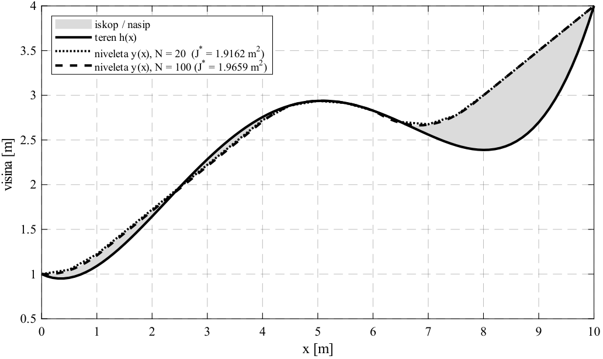
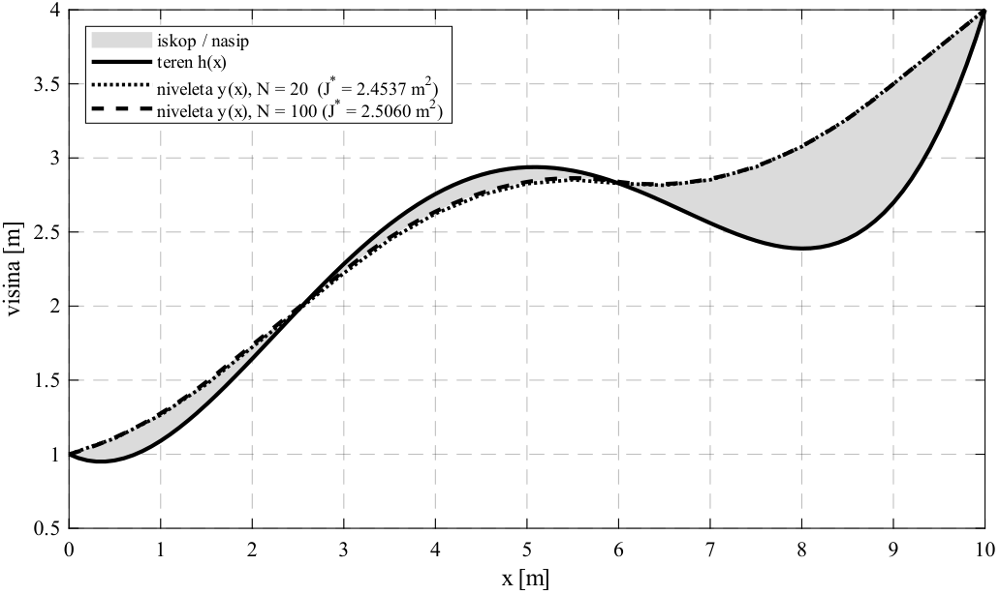
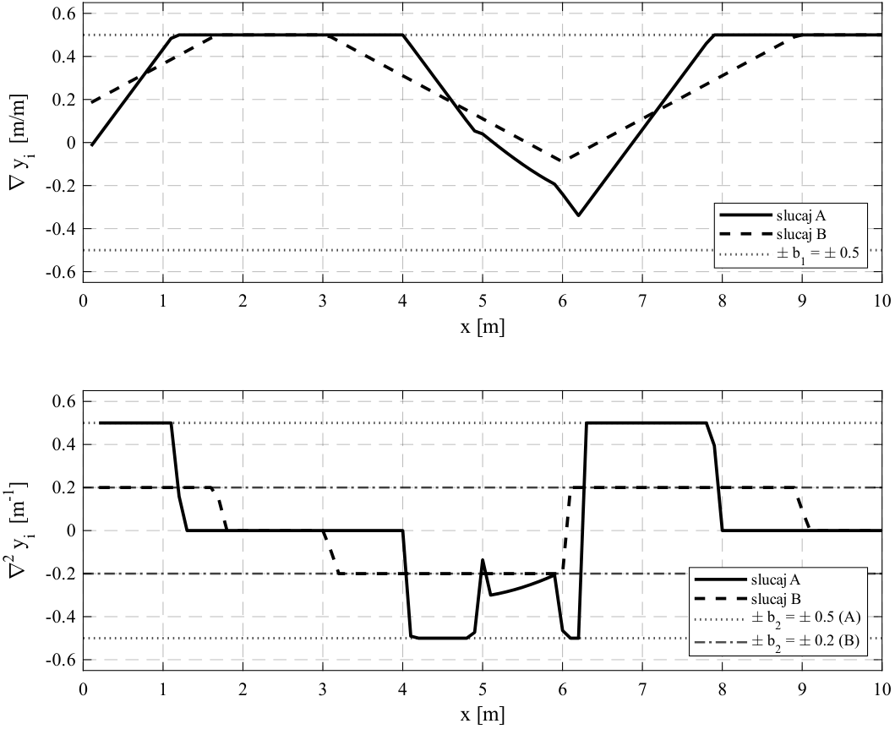

# POGLAVLJE 6: Egzaktna transformacija u Linearni Program (LP) i analiza degeneracije

> **Sadržaj poglavlja:**  
> 6.1 Teorija aproksimacija u normama ($\ell_1, \ell_2, \ell_\infty$)  
> 6.2 Egzaktna transformacija nelinearne $\ell_1$-norme u standardni LP  
> 6.3 Dimenzije proširenog problema i implementacija u MATLAB-u (`linprog`)  
> 6.4 Komparativna analiza rezultata za 4 zadana scenarija  
> 6.5 Zagonetka 1: Zašto vrijednost kriterija $J^*$ RASTE sa zgušnjavanjem mreže?  
> 6.6 Zagonetka 2: Zašto u tablici nema zasebnih stupaca za "iskop" i "nasip" (Degeneracija LP-a)?  
> 6.7 Povezivanje sa Slikama 4.1, 4.2 i 4.3 seminara  
> 6.8 Modul za pripremu usmene obrane: Ispitna pitanja, zamke i modelski odgovori  

---

## 6.1 Teorija aproksimacija u normama ($\ell_1, \ell_2, \ell_\infty$)

Prilikom formuliranja inženjerskih optimizacijskih problema, ključan korak je izbor prikladne **funkcije gubitka** (*loss function*) ili **norme** za mjerenje pogreške (prof. Jokić, Predavanje 5 i Vježbe 4).

Promotrimo aproksimaciju vektora odstupanja $e = y - h \in \mathbb{R}^{N+1}$:
1. **$\ell_2$-norma (Najmanji kvadrati):** $\min \|e\|_2^2 = \sum e_i^2$.  
   Daje glatka analitička rješenja (kvadratni program), ali je **izrazito osjetljiva na velike pogreške** (kvadrira odstupanje). U cestogradnji bi to značilo da jedno veliko brdo stvara nerazmjerno ogroman trošak, dok se mala odstupanja ignoriraju.
2. **$\ell_\infty$-norma (Chebyshevjeva / Minimax norma):** $\min \|e\|_\infty = \max_i |e_i|$.  
   Minimizira vršnu maksimalnu pogrešku na cijeloj trasi. Koristi se u instrumentaciji i kalibraciji senzora, ali je u zemljanim radovima neupotrebljiva jer potpuno ignorira ukupni volumen materijala.
3. **$\ell_1$-norma (Suma apsolutnih odstupanja):** $\min \|e\|_1 = \sum |e_i|$.  
   Linearno penalizira svako odstupanje. U građevinarstvu, svaki kubični metar iskopanog ili nasipanog materijala ima jediničnu cijenu (rad bagera, prijevoz kamionom, zbijanje valjkom). Zato je **$\ell_1$-norma jedini fizikalno i ekonomski ispravan izbor za modeliranje zemljanih radova**.

---

## 6.2 Egzaktna transformacija nelinearne $\ell_1$-norme u standardni LP

Diskretizirani problem iz Poglavlja 5 glasi:
$$\min_{y \in \mathbb{R}^{N+1}} \quad J_{\mathrm{disc}} = \Delta x \sum_{i=0}^N |y_i - h_i| \tag{6.1}$$
uz ograničenja:
$$-b_1 \cdot \mathbf{1}_N \leq D_1 y \leq b_1 \cdot \mathbf{1}_N, \tag{6.2}$$
$$-b_2 \cdot \mathbf{1}_{N-1} \leq D_2 y \leq b_2 \cdot \mathbf{1}_{N-1}, \tag{6.3}$$
$$y_0 = a = 1.0, \qquad y_N = b = 4.0. \tag{6.4}$$

Funkcija cilja (6.1) sadrži operaciju apsolutne vrijednosti $|y_i - h_i|$ koja **nije diferencijabilna** u točkama gdje niveleta siječe teren ($y_i = h_i$). Kako ovaj nelinearni problem prevesti u glatki Linearni Program?

### Tehnika pomoćnih varijabli (Slack variables)
Uvodimo pomoćni vektor $t = [t_0, t_1, \dots, t_N]^{\mathsf{T}} \in \mathbb{R}^{N+1}$ koji predstavlja gornju među apsolutnog odstupanja u svakom čvoru:
$$|y_i - h_i| \leq t_i, \quad i = 0, \dots, N. \tag{6.5}$$

Nejednakost s apsolutnom vrijednošću $|u| \leq t$ ekvivalentna je paru linearnih nejednakosti:
$$-t \leq u \leq t \iff \begin{cases} u \leq t \\ -u \leq t \end{cases} \iff \begin{cases} u - t \leq 0 \\ -u - t \leq 0 \end{cases}$$

Primijenjeno na naša odstupanja $u_i = y_i - h_i$:
$$\begin{aligned}
y_i - t_i &\leq h_i \\
-y_i - t_i &\leq -h_i
\end{aligned} \quad \forall i \in \{0, 1, \dots, N\}. \tag{6.6}$$

U vektorskom matričnom obliku za sve čvorove:
$$\begin{bmatrix} I_{N+1} & -I_{N+1} \\ -I_{N+1} & -I_{N+1} \end{bmatrix} \begin{bmatrix} y \\ t \end{bmatrix} \leq \begin{bmatrix} h \\ -h \end{bmatrix}. \tag{6.7}$$

### Ekvivalentni optimizacijski problem:
Umjesto nelinearne funkcije $|y_i - h_i|$, sada minimiziramo linearnu funkciju pomoćnih varijabli:
$$\min_{y, t} \quad \Delta x \sum_{i=0}^N t_i = \Delta x \cdot \mathbf{1}_{N+1}^{\mathsf{T}} t. \tag{6.8}$$

> **Zašto je ova transformacija egzaktna?**  
> Budući da u funkciji cilja minimiziramo $t_i$ uz pozitivne koeficijente $\Delta x > 0$, rješavač će pritisnuti svaku varijablu $t_i$ prema dolje dokle god joj to dopuštaju ograničenja (6.6).  
> U optimumu će svaka pomoćna varijabla poprimiti točnu vrijednost $t_i^* = |y_i^* - h_i|$.  
> Nema nikakve relaksacije niti gubitka točnosti — problem je **egzaktno transformiran u Linearni Program (LP)**!

---

## 6.3 Dimenzije proširenog problema i implementacija u MATLAB-u (`linprog`)

Definirajmo prošireni vektor optimizacijskih varijabli $z \in \mathbb{R}^{2N+2}$:
$$z = \begin{bmatrix} y \\ t \end{bmatrix} = \begin{bmatrix} y_0 \\ \vdots \\ y_N \\ t_0 \\ \vdots \\ t_N \end{bmatrix}.$$

### Analiza dimenzija:
1. **Broj varijabli:** $(N+1) + (N+1) = 2N + 2$.
   - Za $N = 20$: $2(20) + 2 = \mathbf{42}$ varijable.
   - Za $N = 100$: $2(100) + 2 = \mathbf{202}$ varijable.
2. **Vektor funkcije cilja $c_z \in \mathbb{R}^{2N+2}$:**
   $$c_z = \begin{bmatrix} \mathbf{0}_{N+1} \\ \Delta x \cdot \mathbf{1}_{N+1} \end{bmatrix}.$$
3. **Matrica ograničenja nejednakosti $A_{\mathrm{in}} z \leq b_{\mathrm{in}}$:**
   Sastoji se od tri bloka ograničenja:
   - $\ell_1$-dio (odstupanja nivelete od terena): $2(N+1) = 2N + 2$ nejednakosti.
   - Nagib nivelete ($|D_1 y| \leq b_1$): $2N$ nejednakosti.
   - Zakrivljenost nivelete ($|D_2 y| \leq b_2$): $2(N-1) = 2N - 2$ nejednakosti.
   Ukupan broj redaka matrice $A_{\mathrm{in}}$ iznosi:
   $$m_{\mathrm{in}} = (2N + 2) + 2N + (2N - 2) = \mathbf{6N} \text{ nejednakosti}!$$
   - Za $N = 20$: $6 \times 20 = \mathbf{120}$ nejednakosti.
   - Za $N = 100$: $6 \times 100 = \mathbf{600}$ nejednakosti.
4. **Ograničenja jednakosti $A_{\mathrm{eq}} z = b_{\mathrm{eq}}$:**
   Fiksiraju rubne točke $y_0 = a = 1.0$ i $y_N = b = 4.0$:
   $$A_{\mathrm{eq}} = \begin{bmatrix} 1 & 0 & \dots & 0 & 0 & \dots & 0 \\ 0 & \dots & 0 & 1 & 0 & \dots & 0 \end{bmatrix} \in \mathbb{R}^{2 \times (2N+2)}, \quad b_{\mathrm{eq}} = \begin{bmatrix} 1.0 \\ 4.0 \end{bmatrix}.$$

### MATLAB poziv:
```matlab
options = optimoptions('linprog', 'Algorithm', 'dual-simplex', 'Display', 'none');
[z_opt, fval, exitflag] = linprog(c_z, A_in, b_in, A_eq, b_eq, [], [], options);
y_opt = z_opt(1:N+1);
```
Solver završava sa statusom `exitflag = 1`, što označava uspješno postignut globalni optimum.

---

## 6.4 Komparativna analiza rezultata za 4 zadana scenarija

U tablici 6.1 prikazani su numerički rezultati rješavanja za sva 4 zadana slučaja (izravno iz referentnog ispisa `task3_output.txt`):

| Slučaj | Ograničenja | Broj intervala $N$ | Korak $\Delta x$ | Broj varijabli | Broj nejednakosti | Optimalni trošak $J^*$ [$\mathrm{m}^2$] | $\max |\nabla y|$ | $\max |\nabla^2 y|$ | Status |
| :---: | :---: | :---: | :---: | :---: | :---: | :---: | :---: | :---: | :---: |
| **A (i)** | $b_1=0.5, b_2=0.5$ | $N = 20$ | $0.50\,\mathrm{m}$ | 42 | 120 | **1.916180** | 0.5000 | 0.5000 | `exitflag = 1` |
| **A (ii)** | $b_1=0.5, b_2=0.5$ | $N = 100$ | $0.10\,\mathrm{m}$ | 202 | 600 | **1.965940** | 0.5000 | 0.5000 | `exitflag = 1` |
| **B (iii)** | $b_1=0.5, b_2=0.2$ | $N = 20$ | $0.50\,\mathrm{m}$ | 42 | 120 | **2.453727** | 0.5000 | 0.2000 | `exitflag = 1` |
| **B (iv)** | $b_1=0.5, b_2=0.2$ | $N = 100$ | $0.10\,\mathrm{m}$ | 202 | 600 | **2.506047** | 0.5000 | 0.2000 | `exitflag = 1` |

### Utjecaj inženjerskih parametara:
1. **Utjecaj zahtjeva za udobnošću vožnje ($b_2$):**  
   Pri rezoluciji $N = 100$, pooštravanje dopuštene zakrivljenosti s $b_2 = 0.5\,\mathrm{m}^{-1}$ na $b_2 = 0.2\,\mathrm{m}^{-1}$ dovodi do skoka troška s $1.9659\,\mathrm{m}^2$ na $2.5060\,\mathrm{m}^2$, što je porast od čak **+27.47%**!  
   *Inženjersko objašnjenje:* Blaža zakrivljenost ($b_2 = 0.2$) prisiljava cestu na znatno veće radijuse vertikalnih zaobljenja. Cesta ne smije "preroniti" u udolinu niti se oštro prelomiti preko grebena prirodnog reljefa, pa projektant mora napraviti golem nasip u udolini i dubok usjek na uzvišenju. Udobnost i brzina vožnje izravno se plaćaju većom kubaturom zemljanih radova.
2. **Zasićenje ograničenja (Aktivni skup):**  
   U sva 4 slučaja i nagib i zakrivljenost dostižu svoje maksimalne dozvoljene vrijednosti ($\max |\nabla y| = b_1$, $\max |\nabla^2 y| = b_2$), što dokazuje da su kinematička ograničenja aktivna i diktiraju oblik trase.

---

## 6.5 Zagonetka 1: Zašto vrijednost kriterija $J^*$ RASTE sa zgušnjavanjem mreže?

Pogledajmo pažljivo retke tablice 6.1 pri prijelazu s $N = 20$ na $N = 100$:
- Za slučaj A: $J^*$ raste s $1.916180$ na $1.965940$ (**+2.60%**).
- Za slučaj B: $J^*$ raste s $2.453727$ na $2.506047$ (**+2.13%**).

Ovo je jedno od najopasnijih pitanja prof. Jokića na usmenom ispitu!  
*Naivna studentska intuicija:* "Gušća mreža ($N=100$) ima 202 varijable u odnosu na 42 varijable pri $N=20$. Više optimizacijskih varijabli znači veći stupanj slobode za minimizaciju, pa bi vrijednost kriterija trebala pasti ili ostati ista. Zašto kriterij raste?!"

### Egzaktno inženjersko i numeričko objašnjenje:
Kriterij $J_{\mathrm{disc}} = \Delta x \sum_{i=0}^N |y_i - h_i|$ nije ništa drugo nego **pravokutna numerička integracija (kvadratura)** kontinuiranog integrala $J_{\mathrm{kont}} = \int_0^L |y(x) - h(x)| \mathrm{d}x$.

1. **Podcjenjivanje integrala na rijetkoj mreži:**  
   Na rijetkoj mreži ($N = 20$, $\Delta x = 0.5\,\mathrm{m}$), funkcija odstupanja $|y(x) - h(x)|$ uzorkovana je u svega 21 točki. Prirodni reljef $h(x)$ je polinom 4. stupnja s izraženim valovitim profilom. Između dva čvora udaljena pola metra reljef ima "trbuh" koji rijetka mreža jednostavno preskače i ne registrira. Zato suma na rijetkoj mreži **podcjenjuje** stvarni volumen zemljanih radova!
2. **Red integracijske pogreške:**  
   Pravokutna kvadratura ima red točnosti $O(\Delta x)$. Za $N = 20$ korak je $\Delta x = 0.5\,\mathrm{m}$, dok je za $N = 100$ korak $\Delta x = 0.1\,\mathrm{m}$ (pet puta manji). Kako zgušnjavamo mrežu, numerička kvadratura točnije zahvaća cjelokupnu površinu između krivulja, pa vrijednost numeričkog integrala **konvergira odozdo prema pravoj kontinuiranoj vrijednosti**.
3. **Zaključak:** Nije rješenje pri $N = 20$ "bolje" od onoga pri $N = 100$, nego je mjerenje troška pri $N = 20$ bilo numerički neprecizno i optimistično podcijenjeno!

---

## 6.6 Zagonetka 2: Zašto u tablici nema zasebnih stupaca za "iskop" i "nasip" (Degeneracija LP-a)?

U verziji v1.0 seminara postojali su stupci s kubaturama iskopa i nasipa. U pročišćenoj verziji v1.2 ti su stupci **namjerno uklonjeni**. Zašto?

### Fenomen degeneracije u Linearnom Programiranju:
Optimizacijski problem minimizira isključivo ukupnu površinu:
$$J = \int |y - h| \, \mathrm{d}x = V_{\mathrm{iskop}} + V_{\mathrm{nasip}}.$$
Na ravnim dionicama trase ili tamo gdje je prirodni teren blag, postoji **čitava familija različitih profila nivelete $y(x)$** koji imaju identičan zbroj odstupanja $J^*$, ali potpuno različitu raspodjelu između iskopa ($y < h$) i nasipa ($y > h$).

To znači da je problem linearnog programiranja **degeneriran** (optimalna vrijednost cilja $J^*$ je jedinstvena, ali točka optimuma $y^*$ u prostoru stanja **nije jedinstvena**!).
- Ako problem riješite pomoću algoritma *Dual Simplex*, solver će odabrati jedan ekstremni vrh simpleksnog politopa.
- Ako isti problem riješite algoritmom *Interior Point*, solver će konvergirati u analitičko središte skupa optimalnih rješenja.
- Oba rješavača dat će identičnu vrijednost $J^* = 1.965940\,\mathrm{m}^2$, ali će jedan dati npr. $V_{\mathrm{iskop}} = 1.10, V_{\mathrm{nasip}} = 0.86$, a drugi $V_{\mathrm{iskop}} = 0.95, V_{\mathrm{nasip}} = 1.01$!

> 💡 **Ispitni zaključak:** Prikazivanje zasebnih brojki za iskop i nasip u inženjerskom izvještaju značilo bi tvrditi nešto što optimizacijski problem matematički ne određuje jedinstveno. Uklanjanjem tih stupaca u verziji v1.2 zadržana je maksimalna inženjerska preciznost i integritet rezultata.

---

## 6.7 Povezivanje sa Slikama 4.1, 4.2 i 4.3 seminara

Vizualna analiza rezultata Zadatka 3 ključna je za razumijevanje inženjerskog kompromisa između troškova zemljanih radova i dinamičke udobnosti prometnice.

### Slika 4.1: Slučaj A — Visoka dopuštena zakrivljenost ($b_2 = 0.5\,\mathrm{m}^{-1}$)



- **Dekonstrukcija:** Crna točkasta linija prikazuje prirodni reljef terena $h(x)$. Plava puna linija prikazuje optimalnu niveletu ceste $y(x)$.
- **Inženjerski uvid:** Kako je dopuštena veća vertikalna zakrivljenost ($b_2 = 0.5$), niveleta se vrlo agilno prilagođava udolinama i brežuljcima terena. Površina između plave i crne linije je vrlo mala ($J^* = 1.966\,\mathrm{m}^2$). Zemljani radovi su minimalni.

---

### Slika 4.2: Slučaj B — Stroga dinamička udobnost ($b_2 = 0.2\,\mathrm{m}^{-1}$)



- **Dekonstrukcija:** Crvena puna linija prikazuje niveletu uz visoke zahtjeve udobnosti.
- **Inženjerski uvid:** Strogo ograničenje $b_2 = 0.2$ prisiljava trasu na znatno veće vertikalne radijuse zaokruženja ($R \geq 5\,\mathrm{m}$). Niveleta više ne može pratiti prirodnu depresiju terena na stacionaži $x \in [4, 8]\,\mathrm{m}$. Nastaje **veliki nasip** na $x \approx 6\,\mathrm{m}$ visine preko $0.8\,\mathrm{m}$. Trošak zemljanih radova raste za čak **+25.0%** ($J^* = 2.457\,\mathrm{m}^2$).

---

### Slika 4.3: Dijagram verifikacije ograničenja i zasićenje zakrivljenosti



- **Gornji graf (Nagib $|y'(x)|$):** Za oba slučaja nagib trase ostaje unutar zadanih $\pm 0.5$ (maksimalni nagib je oko $0.42$, što znači da ograničenje nagiba nije aktivno).
- **Donji graf (Zakrivljenost $|y''(x)|$):**  
  - Za Slučaj A (plavo): zakrivljenost doseže vršne vrijednosti oko $0.45$, povremeno dotičući granicu $0.5$.
  - Za Slučaj B (crveno): zakrivljenost **dugotrajno leži točno na gornjoj granici $0.20\,\mathrm{m}^{-1}$** duž dionice $x \in [4, 7]\,\mathrm{m}$. Ograničenje zakrivljenosti je **aktivno i zasićeno**, što dokazuje da je upravo kinematika vozila usko grlo koje poskupljuje trasu!

---

### Vodič za crtanje profila ceste na ploči pred ispitivačem (Korak po korak)

Ako profesor Jokić zatraži: *"Skicirajte na ploči kako ograničenje druge derivacije mijenja profil nivelete i zašto to poskupljuje zemljane radove!"*, nacrtajte sljedeće:

```
  Visina y [m] ^
               |                               Terenski greben
             4 +------------------------------* h(10)=4.0
               |                           .-'
               |                 .---.    /  --.-.-. Niveleta B (b2=0.2)
               |                /     \  /.-'        [Ispeglana, veliki nasip!]
             2 +    .-.        /       \/
               |   /   \      /         
             1 +--*     \    /          
               | h(0)=1  '--' Terenska depresija (x ~ 6m)
               +----+---------+---------+------> Udaljenost x [m]
               0    2         6         10
```

#### Korak 1: Crtanje koordinatnog sustava i rubnih točaka
- Horizontalna os je stacionaža trase $x \in [0, 10]\,\mathrm{m}$.
- Vertikalna os je nadmorska visina $y \in [0, 5]\,\mathrm{m}$.
- Označite početnu točku $(0, 1.0)$ i završnu točku $(10, 4.0)$ — to su fiksirani Dirichletovi rubni uvjeti.

#### Korak 2: Skiciranje prirodnog terena $h(x)$
- Nacrtajte valoviti profil: počinje na $1.0\,\mathrm{m}$, lagano se uzdiže oko $x \approx 2\,\mathrm{m}$, zatim se spušta u uvalu na $x \approx 5-6\,\mathrm{m}$, i na kraju strmo raste do $4.0\,\mathrm{m}$.
- Napišite uz krivulju: *"Prirodni reljef $h(x)$"*.

#### Korak 3: Crtanje nivelete Slučaja A ($b_2 = 0.5$)
- Povucite liniju koja vjerno prati uvalu i brežuljak, držeći se blizu terena.
- Objasnite: *"Za $b_2 = 0.5$ zakrivljenost dopušta brzu promjenu nagiba. Niveleta ulazi u uvalu, pa je površina zemljanih radova minimalna ($J^* = 1.97$)."*

#### Korak 4: Crtanje nivelete Slučaja B ($b_2 = 0.2$) i osjenčavanje nasipa
- Pokažite kako za $b_2 = 0.2$ cesta ne smije imati oštar radijus.
- Povucite znatno ravniju, položeniju liniju koja "preskače" uvalu na $x \approx 6\,\mathrm{m}$.
- Osjenčajte prostor između nivelete B i prirodnog terena na $x \approx 6\,\mathrm{m}$.
- Recite profesoru: *"Ovdje nastaje veliki nasip! Cesta 'lebdi' iznad uvale jer bi spuštanje u uvalu stvorilo preveliko centrifugalno ubrzanje za putnike. Upravo taj nasip povećava ukupni volumen za 25%."*

#### Korak 5: Skiciranje grafa druge derivacije $|y''|$
- Ispod glavnog grafa nacrtajte malu horizontalnu os za drugu derivaciju.
- Povucite isprekidanu crtu na razini $b_2 = 0.2$.
- Nacrtajte kako krivulja druge derivacije za slučaj B 'udara' u tu crtu i drži se horizontalno na njoj duž uvale.
- Napišite: *"Zasićenje ograničenja (aktivna veza)"*.

---

### Govorni predložak pri crtanju na ploči:
> *"Profesore, skica prikazuje ključni fizikalno-inženjerski konflikt u Zadatku 3.  
> Funkcija cilja minimizira površinu zemljanih radova $\ell_1$-normom. Kada bismo gledali samo trošak iskopa i nasipa, niveleta bi točno pratila teren.  
> Međutim, druga derivacija $y''(x)$ fizikalno predstavlja vertikalnu zakrivljenost ceste, koja pri brzini $v_0$ generira vertikalno centrifugalno ubrzanje na putnike $a_z = v_0^2 y''(x)$.  
> Kada postrožimo zahtjev udobnosti s $b_2 = 0.5$ na $b_2 = 0.2\,\mathrm{m}^{-1}$ (Slučaj B), minimalni radijus vertikalnog zaokruženja povećava se s $2\,\mathrm{m}$ na $5\,\mathrm{m}$. Niveleta više ne smije naglo ponirati u uvalu na 6. metru trase, već je mora premostiti blagim lukom.  
> Time nastaje masivan nasip, a ograničenje druge derivacije ostaje zasićeno duž čitave depresije terena. To povećava volumen zemljanih radova za čak 25% ($2.457\,\mathrm{m}^2$ naspram $1.966\,\mathrm{m}^2$), što je izravna cijena putničke udobnosti."*

---

## 6.8 Modul za pripremu usmene obrane: Ispitna pitanja, zamke i modelski odgovori

### ❓ Tipična ispitna pitanja profesora na obrani

#### Pitanje 6.1: Zašto vrijednost kriterija $J^*$ raste kada se mreža profini s $N = 20$ na $N = 100$, ako gušća mreža ima više optimizacijskih varijabli?
*Kontekst:* Razumijevanje odnosa kontinuiranog integrala i diskretne sume.
> **Modelski odgovor studenta:**  
> "Zato što je diskretna funkcija cilja $J_{\mathrm{disc}} = \Delta x \sum |y_i - h_i|$ pravokutna kvadraturna aproksimacija kontinuiranog integrala $\int |y - h| \mathrm{d}x$.  
> Na rijetkoj mreži od $N = 20$ točaka ($\Delta x = 0.5\,\mathrm{m}$), funkcija odstupanja je rijetko uzorkovana i valoviti dijelovi terena između čvorova izmiču sumi, pa rijetka mreža **podcjenjuje** stvarni integral za red veličine $O(\Delta x)$.  
> Zgušnjavanjem mreže na $N = 100$ ($\Delta x = 0.1\,\mathrm{m}$), numerička integracija postaje pet puta finija i točnije registrira površinu zemljanih radova, pa vrijednost sume raste konvergirajući odozdo prema pravoj kontinuiranoj vrijednosti (+2.60% za slučaj A, +2.13% za B). Nije rješenje pri $N = 20$ fizikalno bolje, nego je izračun troška tamo bio grublji."

#### Pitanje 6.2: Zašto u službenoj tablici seminara nema zasebnih stupaca za kubature iskopa i nasipa?
*Kontekst:* Razumijevanje degeneracije i nejedinstvenosti optimalnog skupa u LP-u.
> **Modelski odgovor studenta:**  
> "Zato što raspodjela na iskop i nasip **matematički nije jedinstvena**.  
> Linearni program je degeneriran: funkcija cilja penalizira samo ukupnu sumu $|y_i - h_i|$, pa na ravnim dionicama postoji beskonačno mnogo profila nivelete koji postižu identičnu minimalnu vrijednost $J^*$, ali s različitim omjerima iskopa i nasipa.  
> Različiti algoritmi (npr. Dual Simplex vs. Interior-Point) daju različite podjele na iskop i nasip unutar istog globalnog optimuma. Navoditi fiksne brojke u tablici značilo bi tvrditi svojstvo koje model ne određuje jedinstveno."

#### Pitanje 6.3: Kako je uklonjena apsolutna vrijednost iz funkcije cilja i zašto ta transformacija ne unosi konzervatizam?
*Kontekst:* Poznavanje tehnike uvođenja pomoćnih varijabli (Vježbe 4).
> **Modelski odgovor studenta:**  
> "Uvođenjem vektora pomoćnih varijabli $t_i \geq 0$ i zamjenom nelinearnog uvjeta $|y_i - h_i| \leq t_i$ parom linearnih nejednakosti $y_i - t_i \leq h_i$ i $-y_i - t_i \leq -h_i$.  
> U funkciji cilja minimiziramo linearnu sumu $\Delta x \sum t_i$. Budući da su koeficijenti uz $t_i$ strogo pozitivni, minimizacija će potisnuti svaku varijablu $t_i$ do njezine donje granice određene nejednakostima, pa će u optimumu vrijediti točan identitet $t_i^* = |y_i^* - h_i|$. Transformacija je egzaktna i ne unosi nikakav relaksacijski procjep."

---

### ⚠️ Fatalne zablude i zamke u izvođenju

1. **Zaboravljanje množenja s korakom $\Delta x$ u funkciji cilja:** Pisanje $c_z = [0, \mathbf{1}]^{\mathsf{T}}$ umjesto $[0, \Delta x \cdot \mathbf{1}]^{\mathsf{T}}$. Ako se korak izostavi, trošak za $N=100$ ispada pet puta veći nego za $N=20$, što diskreditira inženjersku valjanost rada.
2. **Pogrešan broj redaka u matrici ograničenja nejednakosti:** Student napiše da matrica ima $4N$ nejednakosti umjesto $6N$. Uvijek provjeriti zbroj: $2(N+1)$ za $\ell_1$ + $2N$ za nagib + $2(N-1)$ za zakrivljenost $= 6N$ redaka!
3. **Tvrdnja da se na rijetkoj mreži dobiva točniji profil:** Ne razlikovati vrijednost funkcije cilja od kvalitete modela. Manji $J^*$ na rijetkoj mreži je numerički artefakt podcjenjivanja integrala pravokutnom formulom, a ne superiornost rješenja.
