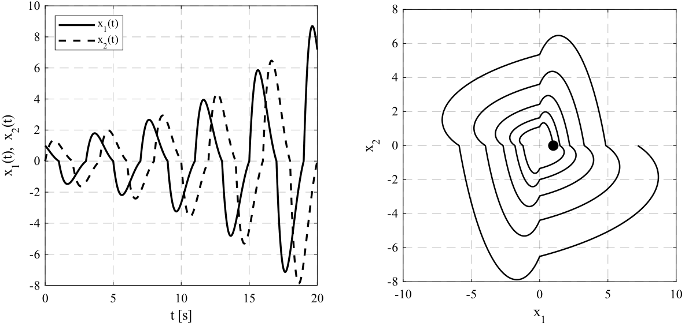

# POGLAVLJE 7: Stabilnost dinamičkih sustava i paradoks sklopnih sustava

> **Sadržaj poglavlja:**  
> 7.1 First Principles stabilnosti kontinuiranih sustava: Hurwitzov kriterij i Ljapunovljeva teorija  
> 7.2 Model hibridnog / sklopnog sustava sa skokovitom promjenom dinamike (Switching Systems)  
> 7.3 Zadatak 4a seminara: Egzaktna provjera Hurwitzovosti pojedinačnih modova  
> 7.4 Paradoks sklopnih sustava: Zašto sustav stabilnih podsustava divergira?  
> 7.5 Analitičko izvođenje monodromijske matrice ciklusa ($\Phi_{\mathrm{cikl}}$) i dokaz nestabilnosti  
> 7.6 Fizikalna interpretacija "pumpanja energije" i geometrija faznog portreta  
> 7.7 Simulacija otvorenog kruga u MATLAB-u (Slika 5.1 seminara)  
> 7.8 Modul za pripremu usmene obrane: Ispitna pitanja, zamke i modelski odgovori  

---

## 7.1 First Principles stabilnosti kontinuiranih sustava: Hurwitzov kriterij i Ljapunovljeva teorija

U teoriji automatskog upravljanja i dinamike sustava, stabilnost je temeljni preduvjet rada bilo kojeg inženjerskog uređaja (prof. Jokić, Predavanje 7).

### Linearni vremenski invarijantni (LTI) sustavi
Promatramo kontinuirani autonomni LTI sustav u prostoru stanja:
$$\dot{x}(t) = A x(t), \qquad x(0) = x_0, \tag{7.1}$$
gdje je $x(t) \in \mathbb{R}^n$ vektor stanja, a $A \in \mathbb{R}^{n \times n}$ matrica sustava (matrica dinamike).

Egzaktno analitičko rješenje diferencijalne jednadžbe (7.1) dano je preko **matričnog eksponenta**:
$$x(t) = e^{At} x_0, \qquad e^{At} := \sum_{k=0}^\infty \frac{(At)^k}{k!} = I + At + \frac{A^2 t^2}{2!} + \dots \tag{7.2}$$

### Definicije stabilnosti u smislu Ljapunova
1. **Stabilnost po Ljapunovu:** Sustav je stabilan ako za svaki $\epsilon > 0$ postoji $\delta > 0$ takav da iz $\|x(0)\| < \delta$ slijedi $\|x(t)\| < \epsilon$ za sve $t \geq 0$ (trajektorije ostaju omeđene).
2. **Asimptotska stabilnost:** Sustav je stabilan po Ljapunovu i dodatno vrijedi da sva stanja konvergiraju u ravnotežnu točku: $\lim_{t \to \infty} x(t) = 0$.
3. **Eksponencijalna stabilnost:** Postoje konstante $M \geq 1$ i $\alpha > 0$ takve da za sve trajektorije vrijedi:
   $$\|x(t)\| \leq M e^{-\alpha t} \|x(0)\|, \quad \forall t \geq 0. \tag{7.3}$$
   Veličina $\alpha$ naziva se **stopa eksponencijalnog prigušenja** (*decay rate*).

> **Teorem 7.1 (Hurwitzov kriterij za LTI sustave):**  
> Za LTI sustav $\dot{x} = Ax$ sljedeće tvrdnje su međusobno ekvivalentne:
> 1. Sustav je asimptotski (i eksponencijalno) stabilan.
> 2. Sve svojstvene vrijednosti matrice $A$ leže u otvorenoj lijevoj poluravnini kompleksne ravnine:
>    $$\mathrm{Re}(\lambda_i(A)) < 0, \quad \forall i \in \{1, \dots, n\}.$$
>    Takva matrica naziva se **Hurwitzova matrica**.
> 3. Za bilo koju simetričnu pozitivno definitnu matricu $Q \succ 0$, postoji jedinstvena simetrična pozitivno definitna matrica $P \succ 0$ koja zadovoljava **Ljapunovljevu matričnu jednadžbu**:
>    $$A^{\mathsf{T}} P + P A = -Q \prec 0. \tag{7.4}$$
>    Funkcija $V(x) = x^{\mathsf{T}} P x$ tada je striktna Ljapunovljeva funkcija sustava čija je derivacija duž trajektorija strogo negativna:
>    $$\dot{V}(x) = \dot{x}^{\mathsf{T}} P x + x^{\mathsf{T}} P \dot{x} = x^{\mathsf{T}} (A^{\mathsf{T}} P + P A) x = -x^{\mathsf{T}} Q x < 0, \quad \forall x \neq 0.$$

---

## 7.2 Model hibridnog / sklopnog sustava sa skokovitom promjenom dinamike (Switching Systems)

U Zadatku 4 seminara promatramo vremenski promjenjiv dinamički sustav:
$$\dot{x}(t) = A(t) x(t) + B u(t), \qquad x(t) \in \mathbb{R}^2, \quad u(t) \in \mathbb{R}, \tag{7.5}$$
s matricom ulaza:
$$B = \begin{bmatrix} 1 \\ 0 \end{bmatrix}.$$

Matrica dinamike $A(t)$ nije konstantna, već skokovito mijenja vrijednost na svakoj cjelobrojnoj sekundi prema pravilu:
$$A(t) = \begin{cases} A_{\mathrm{parno}}, & \text{kad je } \lfloor t \rfloor \text{ paran broj} \\ A_{\mathrm{neparno}}, & \text{kad je } \lfloor t \rfloor \text{ neparan broj} \end{cases} \tag{7.6}$$
gdje $\lfloor t \rfloor$ označava funkciju najvećeg cijelog broja manjeg ili jednakog $t$ (*floor function*).

Zadane matrice dinamike modova glase:
$$A_{\mathrm{parno}} = \begin{bmatrix} -1 & -\frac{\pi}{6} \\[4pt] \frac{3\pi}{2} & -1 \end{bmatrix}, \qquad A_{\mathrm{neparno}} = \begin{bmatrix} -1 & -\frac{3\pi}{2} \\[4pt] \frac{\pi}{6} & -1 \end{bmatrix}. \tag{7.7}$$

### Klasifikacija sustava
Ovdje je riječ o **sklopnom sustavu** (*switched linear system*), koji pripada široj klasi **hibridnih sustava**.  
- Između svaka dva trenutka prespajanja (unutar intervala $t \in [k, k+1)$) sustav se ponaša kao običan LTI sustav.
- Sustav ima dva diskretna stanja (dva dinamička moda): **parni mod** za $t \in [0,1) \cup [2,3) \cup \dots$ i **neparni mod** za $t \in [1,2) \cup [3,4) \cup \dots$
- Period ciklusa prespajanja iznosi točno:
  $$T_{\mathrm{cikl}} = 1\,\mathrm{s} + 1\,\mathrm{s} = 2.0\,\mathrm{s}.$$

---

## 7.3 Zadatak 4a seminara: Egzaktna provjera Hurwitzovosti pojedinačnih modova

Prvo pitanje glasi: *"Jesu li matrice $A_{\mathrm{parno}}$ i $A_{\mathrm{neparno}}$ stabilne (Hurwitzove) matrice?"*

### Analiza parnog moda ($A_{\mathrm{parno}}$):
Karakteristična jednadžba glasi:
$$\det(\lambda I - A_{\mathrm{parno}}) = \det \begin{bmatrix} \lambda + 1 & \frac{\pi}{6} \\[4pt] -\frac{3\pi}{2} & \lambda + 1 \end{bmatrix} = (\lambda + 1)^2 - \left( -\frac{3\pi}{2} \right) \left( \frac{\pi}{6} \right) = 0,$$
$$(\lambda + 1)^2 + \frac{3\pi^2}{12} = (\lambda + 1)^2 + \frac{\pi^2}{4} = 0.$$
Odavde slijedi:
$$(\lambda + 1)^2 = -\frac{\pi^2}{4} \implies \lambda + 1 = \pm j \frac{\pi}{2}.$$
Svojstvene vrijednosti parnog moda su konjugirano-kompleksni par:
$$\lambda_{1,2}(A_{\mathrm{parno}}) = -1 \pm j \frac{\pi}{2} \approx -1.000000 \pm 1.570796 j. \tag{7.8}$$

### Analiza neparnog moda ($A_{\mathrm{neparno}}$):
Karakteristična jednadžba glasi:
$$\det(\lambda I - A_{\mathrm{neparno}}) = \det \begin{bmatrix} \lambda + 1 & \frac{3\pi}{2} \\[4pt] -\frac{\pi}{6} & \lambda + 1 \end{bmatrix} = (\lambda + 1)^2 - \left( -\frac{\pi}{6} \right) \left( \frac{3\pi}{2} \right) = (\lambda + 1)^2 + \frac{\pi^2}{4} = 0.$$
Karakteristični polinom je **potpuno identičan** kao za parni mod! Svojstvene vrijednosti neparnog moda su:
$$\lambda_{1,2}(A_{\mathrm{neparno}}) = -1 \pm j \frac{\pi}{2} \approx -1.000000 \pm 1.570796 j. \tag{7.9}$$

> **Zaključak za Zadatak 4a:**  
> Realni dijelovi svih svojstvenih vrijednosti oba moda iznose:
> $$\mathrm{Re}(\lambda) = -1.000000 < 0.$$
> **Obje matrice su Hurwitzove.** Kada bi sustav trajno ostao u parnom modu ili trajno u neparnom modu, bio bi asimptotski stabilan s prigušenim oscilacijama frekvencije $\omega = \frac{\pi}{2}\,\mathrm{rad/s}$ i vremenskom konstantom smirivanja $\tau = 1\,\mathrm{s}$.

---

## 7.4 Paradoks sklopnih sustava: Zašto sustav stabilnih podsustava divergira?

U podzadatku 4b provodimo simulaciju otvorenog kruga ($u(t) \equiv 0$) s početnim uvjetom $x(0) = \begin{bmatrix} 1 \\ 0 \end{bmatrix}$ kroz vrijeme $t \in [0, 20]\,\mathrm{s}$.

Rezultat simulacije (prikazan na Slici 5.1 seminara i u datoteci `task4_output.txt`) je šokantan za svakog studenta koji se prvi put susreće s hibridnim sustavima:
$$\|x(0)\| = 1.0000 \implies \|x(20)\| = \mathbf{7.1868}!$$
**Sustav ne samo da ne konvergira u nulu, nego divlje oscilira i eksponencijalno divergira u beskonačnost!**

Kako je moguće da sustav sastavljen od dva dokazano stabilna, Hurwitzova moda postane nestabilan jednostavnim prespajanjem svake sekunde?

---

## 7.5 Analitičko izvođenje monodromijske matrice ciklusa ($\Phi_{\mathrm{cikl}}$) i dokaz nestabilnosti

Kako bismo na usmenom ispitu briljirali, nećemo samo pokazati simulacijski graf, već ćemo izvesti **egzaktni analitički dokaz nestabilnosti** pomoću Floquetove teorije i monodromijske matrice prijelaza (prof. Jokić, Predavanje 7).

### Korak 1: Izračun matrice prijelaza za pojedinačni mod
Unutar segmenta duljine $\Delta t = 1\,\mathrm{s}$, matrica dinamike je konstantna. Matrica prijelaza stanja parnog moda glasi $\Phi_{\mathrm{parno}} = e^{A_{\mathrm{parno}} \cdot 1}$.  
Rastavimo matricu $A_{\mathrm{parno}}$ na dijagonalni dio i matricu rotacije:
$$A_{\mathrm{parno}} = -I + \Omega_{\mathrm{par}}, \qquad \Omega_{\mathrm{par}} = \begin{bmatrix} 0 & -\frac{\pi}{6} \\[4pt] \frac{3\pi}{2} & 0 \end{bmatrix}.$$
Budući da skalarna matrica $-I$ komutira sa svakom matricom ($-I \cdot \Omega = \Omega \cdot (-I)$), matrični eksponent se egzaktno rastavlja:
$$e^{A_{\mathrm{parno}} \cdot 1} = e^{-I \cdot 1} \cdot e^{\Omega_{\mathrm{par}} \cdot 1} = e^{-1} e^{\Omega_{\mathrm{par}}}.$$

Izračunajmo potencije matrice $\Omega_{\mathrm{par}}$:
$$\Omega_{\mathrm{par}}^2 = \begin{bmatrix} 0 & -\frac{\pi}{6} \\[4pt] \frac{3\pi}{2} & 0 \end{bmatrix} \begin{bmatrix} 0 & -\frac{\pi}{6} \\[4pt] \frac{3\pi}{2} & 0 \end{bmatrix} = \begin{bmatrix} -\frac{3\pi^2}{12} & 0 \\[4pt] 0 & -\frac{3\pi^2}{12} \end{bmatrix} = -\frac{\pi^2}{4} I = -\omega^2 I, \quad \text{uz } \omega = \frac{\pi}{2}.$$
Budući da je $\Omega_{\mathrm{par}}^2 = -\omega^2 I$, Taylorov red matrice $e^{\Omega_{\mathrm{par}}}$ svodi se na trigonometrijske funkcije:
$$e^{\Omega_{\mathrm{par}} \cdot 1} = \cos(\omega) I + \frac{\sin(\omega)}{\omega} \Omega_{\mathrm{par}} = \cos\left(\frac{\pi}{2}\right) I + \frac{\sin(\pi/2)}{\pi/2} \begin{bmatrix} 0 & -\frac{\pi}{6} \\[4pt] \frac{3\pi}{2} & 0 \end{bmatrix}.$$
Kako je $\cos(\pi/2) = 0$ i $\sin(\pi/2) = 1$:
$$e^{\Omega_{\mathrm{par}}} = \frac{1}{\pi/2} \begin{bmatrix} 0 & -\frac{\pi}{6} \\[4pt] \frac{3\pi}{2} & 0 \end{bmatrix} = \begin{bmatrix} 0 & -\frac{\pi/6}{\pi/2} \\[4pt] \frac{3\pi/2}{\pi/2} & 0 \end{bmatrix} = \begin{bmatrix} 0 & -\frac{1}{3} \\[4pt] 3 & 0 \end{bmatrix}!$$

Uvrštavanjem faktora $e^{-1}$ dobivamo **egzaktnu matricu prijelaza parnog moda**:
$$\Phi_{\mathrm{parno}} = e^{-1} \begin{bmatrix} 0 & -\frac{1}{3} \\[4pt] 3 & 0 \end{bmatrix} = \begin{bmatrix} 0 & -\frac{1}{3} e^{-1} \\[4pt] 3 e^{-1} & 0 \end{bmatrix} \approx \begin{bmatrix} 0.000000 & -0.122626 \\[4pt] 1.103638 & 0.000000 \end{bmatrix}. \tag{7.10}$$

### Korak 2: Matrica prijelaza neparnog moda
Potpuno analognim postupkom za neparni mod $\Omega_{\mathrm{nep}} = \begin{bmatrix} 0 & -\frac{3\pi}{2} \\ \frac{\pi}{6} & 0 \end{bmatrix}$ dobivamo:
$$\Phi_{\mathrm{neparno}} = e^{-1} \begin{bmatrix} 0 & -3 \\[4pt] \frac{1}{3} & 0 \end{bmatrix} = \begin{bmatrix} 0 & -3 e^{-1} \\[4pt] \frac{1}{3} e^{-1} & 0 \end{bmatrix} \approx \begin{bmatrix} 0.000000 & -1.103638 \\[4pt] 0.122626 & 0.000000 \end{bmatrix}. \tag{7.11}$$

### Korak 3: Monodromijska matrica ciklusa ($\Phi_{\mathrm{cikl}}$)
Jedan puni ciklus sustava traje $T_{\mathrm{cikl}} = 2\,\mathrm{s}$ (prvo 1 s parnog moda, zatim 1 s neparnog moda).  
Stanje sustava nakon jednog punog ciklusa povezano je s početnim stanjem preko **monodromijske matrice prijelaza**:
$$x(2) = \Phi_{\mathrm{neparno}} \cdot x(1) = \Phi_{\mathrm{neparno}} \cdot \Phi_{\mathrm{parno}} \cdot x(0) = \Phi_{\mathrm{cikl}} \cdot x(0).$$

Izmnožimo matrice (7.11) i (7.10):
$$\Phi_{\mathrm{cikl}} = \Phi_{\mathrm{neparno}} \Phi_{\mathrm{parno}} = \left( e^{-1} \begin{bmatrix} 0 & -3 \\[4pt] \frac{1}{3} & 0 \end{bmatrix} \right) \left( e^{-1} \begin{bmatrix} 0 & -\frac{1}{3} \\[4pt] 3 & 0 \end{bmatrix} \right) = e^{-2} \begin{bmatrix} (-3)(3) & 0 \\[4pt] 0 & \left(\frac{1}{3}\right)\left(-\frac{1}{3}\right) \end{bmatrix} = e^{-2} \begin{bmatrix} -9 & 0 \\[4pt] 0 & -\frac{1}{9} \end{bmatrix}! \tag{7.12}$$

Uvrstimo numeričku vrijednost baze $e^{-2} = \frac{1}{e^2} \approx \frac{1}{7.389056} \approx 0.135335$:
$$\Phi_{\mathrm{cikl}} = \begin{bmatrix} -9 e^{-2} & 0 \\[4pt] 0 & -\frac{1}{9} e^{-2} \end{bmatrix} \approx \begin{bmatrix} -1.218018 & 0.000000 \\[4pt] 0.000000 & -0.015037 \end{bmatrix}. \tag{7.13}$$

### Korak 4: Spektralni radijus i dokaz nestabilnosti
Budući da je matrica $\Phi_{\mathrm{cikl}}$ dijagonalna, njezine svojstvene vrijednosti su njezini dijagonalni elementi:
$$\mu_1 = -9 e^{-2} \approx -1.218018, \qquad \mu_2 = -\frac{1}{9} e^{-2} \approx -0.015037.$$

**Spektralni radijus** monodromijske matrice definira se kao maksimalni modul svojstvenih vrijednosti:
$$\rho(\Phi_{\mathrm{cikl}}) := \max_i |\mu_i| = 9 e^{-2} \approx \mathbf{1.218018} > 1! \tag{7.14}$$

> 🔴 **MATEMATIČKI DOKAZ DIVERGENCIJE:**  
> Stanje sustava u stroboskopskim trenucima na krajevima ciklusa ($t = 2k$, $k = 0, 1, 2, \dots$) ponaša se kao diskretni sustav:
> $$x(2k) = (\Phi_{\mathrm{cikl}})^k x(0).$$
> Za zadani početni uvjet $x(0) = \begin{bmatrix} 1 \\ 0 \end{bmatrix}$, prva komponenta stanja iznosi:
> $$x_1(2k) = (-1.218018)^k \cdot 1.$$
> Nakon svakog ciklusa od 2 sekunde, stanje mijenja predznak i **amplituda mu naraste za 21.8%**!  
> Nakon $T = 20\,\mathrm{s}$ (što je $k = 10$ ciklusa), amplituda iznosi:
> $$|x_1(20)| = (1.218018)^{10} \approx 7.1868.$$
> Budući da je $\rho(\Phi_{\mathrm{cikl}}) > 1$, sustav je **eksponencijalno nestabilan**! $\blacksquare$

---

## 7.6 Fizikalna interpretacija "pumpanja energije" i geometrija faznog portreta

Zašto se ovo događa? Kako periodičko prespajanje unosi energiju u sustav?

1. **Geometrija elipsoida nivoa energije:**  
   Za parni mod, nivo-krivulje energije (Ljapunovljeve funkcije $V_{\mathrm{par}}(x)$) su izdužene elipse čija je glavna poluos u smjeru osi $x_1$ tri puta dulja nego u smjeru $x_2$ (omjer osi $3 : 1$).  
   Za neparni mod, elipse su zarotirane za $90^\circ$ — glavna os je izdužena u smjeru $x_2$ (omjer osi $1 : 3$).
2. **Mehanizam pumpanja energije:**  
   - Kroz prvu sekundu (parni mod), trajektorija se giba duž svoje elipse i skuplja se prema ishodištu faktorom $e^{-1}$, ali rotira za kut $\pi/2$ tako da završava točno na osi $x_2$.
   - U sekundi $t = 1.0\,\mathrm{s}$, sustav skokovito prespaja na neparni mod. No, točka na osi $x_2$ za neparni mod leži na **vrlo visokoj energetskoj razini**!
   - Kroz drugu sekundu trajektorija rotira natrag na os $x_1$, gdje u trenutku $t = 2.0\,\mathrm{s}$ prespajanje ponovno pronalazi točku na još višoj energetskoj razini parnog moda.
   - Iako unutar svakog moda sustav disipira energiju, **skokovita promjena koordinatnih osi elipsoida djeluje kao parametarska rezonancija** koja ubacuje više energije nego što je podsustavi stignu disipirati!

---

## 7.7 Simulacija otvorenog kruga u MATLAB-u (Slika 5.1 seminara)

### Segmentna simulacija s `ode45`:
Budući da je matrica dinamike po dijelovima konstantna, numerička simulacija provodi se po segmentima duljine $1\,\mathrm{s}$:
```matlab
A_par = [-1, -pi/6;   3*pi/2, -1];
A_nep = [-1, -3*pi/2; pi/6,   -1];
x0 = [1; 0];  T = 20;

xc = x0;
for kseg = 0:T-1
    if mod(kseg, 2) == 0, Aa = A_par; else, Aa = A_nep; end
    o = odeset('RelTol', 1e-9, 'AbsTol', 1e-11);
    [ts, xs] = ode45(@(t, x) Aa*x, [kseg, kseg+1], xc, o);
    xc = xs(end, :)'; % Završno stanje segmenta postaje početno stanje sljedećeg
end
```

### Prikaz simulacije otvorenog kruga (Slika 5.1 seminara)



#### Detaljna dekonstrukcija elemenata grafa:
1. **Lijevi graf — Vremenski odziv stanja $x_1(t)$ i $x_2(t)$:**
   - Horizontalna os je vrijeme $t \in [0, 20]\,\mathrm{s}$.
   - Vertikalna os je amplituda stanja.
   - Prikazuje periodičke oscilacije koje u svakom koraku prespajanja (svake 2 sekunde) rastu za faktor $\rho(\Phi_{\mathrm{cikl}}) \approx 1.218$. Na $t = 20\,\mathrm{s}$ amplituda prelazi $\pm 7.0$ (eksponencijalna divergencija).
2. **Desni graf — Fazni portret ($x_1$ vs. $x_2$):**
   - Početni uvjet je $x(0) = [1, 0]^\mathsf{T}$ (zeleni kružić na osi $x_1$).
   - Trajektorija tvori spiralu koja se **odmotava prema van** (centrifugalno širenje).
   - Svaki prolazak kroz ravninu je na većem radijusu nego prethodni. Sustav je nedvojbeno nestabilan!

---

### Vodič za skiciranje faznog portreta sklopnog sustava na ploči pred ispitivačem

Ako profesor Jokić zatraži: *"Skicirajte na ploči fazni portret ovog sustava i objasnite zašto dolazi do divergencije unatoč Hurwitzovim podsustavima!"*, postupite ovako:

```
            x2 ^
               |        ^ / Trajektorija moda 2 (spljoštena duž x2)
               |       / /
               |      / /     Trajektorija moda 1 (izdužena duž x2)
               |     | |     /
          -----+-----+-------+-----> x1
               |     | |   x(0)=[1, 0]
               |      \ \   /
               |       \ \ v
               |        \ \
```

#### Korak 1: Crtanje koordinatnih osi fazne ravnine
- Nacrtajte osi $x_1$ i $x_2$. Označite početnu točku $x(0) = [1, 0]^\mathsf{T}$ na pozitivnom dijelu osi $x_1$.

#### Korak 2: Objašnjenje geometrije Moda 1 (Parni mod)
- Matrica je $A_{\mathrm{parno}} = \begin{bmatrix} -1 & -\pi/6 \\ 3\pi/2 & -1 \end{bmatrix}$. Član ispod dijagonale ($3\pi/2 \approx 4.71$) znatno je veći od člana iznad ($-\pi/6 \approx -0.52$).
- To znači da mod 1 snažno ubrzava stanje $x_2$: trajektorije su **izdužene duž vertikalne osi $x_2$**.
- Kroz interval $t \in [0, 1]\,\mathrm{s}$, stanje rotira u smjeru kazaljke na satu za kut $\pi/2$ (četvrtinu kruga), uz faktor prigušenja $e^{-1}$, ali zbog asimetrije matrice izdužuje se duž osi $x_2$:
  $$x(1) = \Phi_{\mathrm{parno}} x(0) = e^{-1} \begin{bmatrix} 0 \\ 3 \end{bmatrix} \approx \begin{bmatrix} 0 \\ 1.1036 \end{bmatrix}.$$
- Nacrtajte luk od točke $(1, 0)$ do točke $(0, 1.10)$ na osi $x_2$.
- Istaknite: *"Početna amplituda bila je $1.0$, a na kraju prvog moda stanje je $1.10$ — sustav je zapravo narastao!"*

#### Korak 3: Objašnjenje geometrije Moda 2 (Neparni mod)
- U trenutku $t = 1\,\mathrm{s}$ sustav prelazi u neparni mod: $A_{\mathrm{neparno}} = \begin{bmatrix} -1 & -3\pi/2 \\ \pi/6 & -1 \end{bmatrix}$.
- Ovdje je gornji član $-3\pi/2$ velik, pa su trajektorije **izdužene duž horizontalne osi $x_1$**.
- U sljedećoj sekundi ($t \in [1, 2]\,\mathrm{s}$), trajektorija rotira za još $\pi/2$ i završava na negativnom dijelu osi $x_1$:
  $$x(2) = \Phi_{\mathrm{neparno}} x(1) = e^{-1} \begin{bmatrix} 0 & -3 \\ 1/3 & 0 \end{bmatrix} \begin{bmatrix} 0 \\ 3 e^{-1} \end{bmatrix} = e^{-2} \begin{bmatrix} -9 \\ 0 \end{bmatrix} \approx \begin{bmatrix} -1.218 \\ 0 \end{bmatrix}.$$
- Nacrtajte luk od $(0, 1.10)$ do $(-1.22, 0)$ na negativnoj osi $x_1$.

#### Korak 4: Crtanje odmotavajuće spirale
- Pokažite da je nakon punog ciklusa ($2\,\mathrm{s}$) točka završila na udaljenosti $1.218$ od ishodišta, umjesto početnih $1.0$.
- Nastavite crtati spiralu: u sljedećem krugu točka doseže $(-1.218) \times (-1.218) = 1.48$, zatim $1.81$, itd.
- Nacrtajte spiralu koja se odmotava prema van.

---

### Govorni predložak pri crtanju na ploči:
> *"Profesore, skica na ploči vizualizira mehanizam nestabilnosti.  
> Oba moda zasebno imaju prigušenje $e^{-1 \cdot t}$, ali imaju različito orijentirane eliptičke trajektorije u faznoj ravnini.  
> Parni mod je izdužen duž osi $x_2$ s faktorom rastezanja 3. Kroz prvu sekundu on zakreće točku $(1,0)$ na os $x_2$ i rasteže je na $3 e^{-1} \approx 1.10$.  
> U tom trenutku skačemo u neparni mod koji je izdužen duž osi $x_1$ s faktorom rastezanja 3. On zakreće točku na os $x_1$ i ponovno je rasteže za faktor 3.  
> Ukupni faktor rastezanja u jednom ciklusu je $3 \times 3 = 9$, dok je prirodno prigušenje samo $e^{-2} \approx 0.135$.  
> Umnožak daje $9 e^{-2} \approx 1.218 > 1$. Prespajanje se događa u najgorim mogućim trenucima — točno kada je stanje poravnato s osi maksimalnog rastezanja svakog moda! To djeluje kao parametarska rezonancija koja pumpa energiju u sustav i uzrokuje spiralnu divergenciju otvorenog kruga."*

---

## 7.8 Modul za pripremu usmene obrane: Ispitna pitanja, zamke i modelski odgovori

### ❓ Tipična ispitna pitanja profesora na obrani

#### Pitanje 7.1: Kako je moguće da je sklopni sustav nestabilan ako su oba njegova dinamička moda Hurwitzova?
*Kontekst:* Glavno konceptualno pitanje iz teorije sklopnih sustava.
> **Modelski odgovor studenta:**  
> "Hurwitzovost pojedinačnih matrica jamči stabilnost samo ako sustav trajno ostane u jednom modu. Čim postoji prespajanje, svojstvene vrijednosti pojedinih matrica više ne određuju stabilnost.  
> Za periodičko prespajanje mjerodavna je **monodromijska matrica ciklusa** $\Phi_{\mathrm{cikl}} = e^{A_{\mathrm{neparno}}} e^{A_{\mathrm{parno}}}$.  
> Umnožak dviju matrica koje zasebno imaju spektralni radijus manji od jedan općenito ne mora imati spektralni radijus manji od jedan. U našem slučaju je $\Phi_{\mathrm{cikl}} = e^{-2} \mathrm{diag}(-9, -1/9)$, pa je spektralni radijus $\rho(\Phi_{\mathrm{cikl}}) = 9 e^{-2} \approx 1.218 > 1$. Geometrijski, elipsoidi nivoa energije dvaju modova nisu usklađeni, pa prespajanje djeluje kao parametarska rezonancija koja pumpa energiju u sustav brže nego što je disipacija može odvesti."

#### Pitanje 7.2: Što je monodromijska matrica i kako se ona analitički računa?
*Kontekst:* Provjera matematičkog izvođenja matrice prijelaza.
> **Modelski odgovor studenta:**  
> "Monodromijska matrica $\Phi_{\mathrm{cikl}}$ je stroboskopska matrica prijelaza stanja preko jednog punog perioda prespajanja $T_{\mathrm{cikl}}$, takva da vrijedi $x(t + T_{\mathrm{cikl}}) = \Phi_{\mathrm{cikl}} x(t)$.  
> Računa se analitičkim množenjem matričnih eksponenata pojedinih modova: $\Phi_{\mathrm{cikl}} = e^{A_2 \Delta t_2} e^{A_1 \Delta t_1}$.  
> Koristeći dekompoziciju matrica $A_i = -I + \Omega_i$ i činjenicu da je $\Omega_i^2 = -(\pi/2)^2 I$, matrični eksponenti se svode na trigonometrijske funkcije, što daje egzaktne matrice prijelaza $\Phi_{\mathrm{parno}} = e^{-1} \begin{bmatrix} 0 & -1/3 \\ 3 & 0 \end{bmatrix}$ i $\Phi_{\mathrm{neparno}} = e^{-1} \begin{bmatrix} 0 & -3 \\ 1/3 & 0 \end{bmatrix}$. Njihov umnožak daje dijagonalnu matricu $\Phi_{\mathrm{cikl}} = e^{-2} \mathrm{diag}(-9, -1/9)$."

#### Pitanje 7.3: Može li sklopni sustav sastavljen od dva NESTABILNA moda prespajanjem postati stabilan?
*Kontekst:* Povezivanje dualnog fenomena sklopnih sustava (Predavanje 7).
> **Modelski odgovor studenta:**  
> "Da, apsolutno! Fenomen funkcionira i u suprotnom smjeru.  
> Kao što nepovoljno prespajanje stabilnih podsustava može destabilizirati sustav, tako i pažljivo projektirano prespajanje između dva nestabilna podsustava može rezultirati stabilnim sustavom.  
> Ključ je u tome da se prespajanje tempira u trenucima kada trajektorija prvog nestabilnog moda prolazi kroz regiju prostora stanja gdje drugi mod ima kontrakciju. Ako monodromijska matrica umnoška ima spektralni radijus $\rho(\Phi_{\mathrm{cikl}}) < 1$, zatvoreni sklopni sustav bit će eksponencijalno stabilan."

---

### ⚠️ Fatalne zablude i zamke u izvođenju

1. **Pokušaj dokazivanja stabilnosti preko zbira ili prosjeka svojstvenih vrijednosti:** Student tvrdi da je sustav stabilan jer je prosječna matrica $\frac{1}{2}(A_{\mathrm{par}} + A_{\mathrm{nep}})$ Hurwitzova. To je potpuno pogrešno: dinamika sklopnog sustava određena je umnoškom matričnih eksponenata, a ne prosjekom matrica!
2. **Pogrešan redoslijed množenja matrica prijelaza:** Pisanje $\Phi_{\mathrm{cikl}} = \Phi_{\mathrm{parno}} \Phi_{\mathrm{neparno}}$ umjesto $\Phi_{\mathrm{neparno}} \Phi_{\mathrm{parno}}$. Budući da sustav u prvom intervalu $t \in [0, 1)$ evoluira pod parnim modom, stanje na kraju ciklusa je $x(2) = \Phi_{\mathrm{neparno}} x(1) = \Phi_{\mathrm{neparno}} \Phi_{\mathrm{parno}} x(0)$. Matrice se primjenjuju s desna na lijevo!
3. **Miješanje determinirane nestabilnosti s kaosom:** Nestabilnost u Zadatku 4b nije kaos niti slučajni šum, već determinirana eksponencijalna divergencija linearne strukture po dijelovima sa strogom stopom rasta od $1.218$ po ciklusu.
