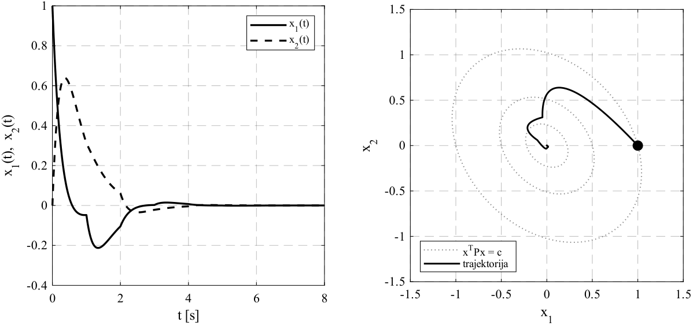

# POGLAVLJE 8: Linearne matrične nejednakosti (LMI) i sinteza robusnog upravljanja

> **Sadržaj poglavlja:**  
> 8.1 First Principles Semidefinitnog programiranja (SDP) i Linearne Matrične Nejednakosti (LMI)  
> 8.2 Koncept zajedničke kvadratne Ljapunovljeve funkcije (CQLF)  
> 8.3 Problem bilinearne matrične nejednakosti (BMI) kod sinteze upravljanja  
> 8.4 Linearizacija: Transformacija kongruencije i supstitucija varijabli ($\mathcal{Q} = P^{-1}, Y = KP^{-1}$)  
> 8.5 Solverska implementacija u YALMIP-u: Eliminacija homogenosti i minimalno pojačanje ($\min \|Y\|_2$)  
> 8.6 Poopćeni problem svojstvenih vrijednosti (GEVP) i egzaktna stopa prigušenja $\alpha = 0.2884\,\mathrm{s}^{-1}$  
> 8.7 Simulacija zatvorenog kruga i elipsoidna kontrakcija (Slika 5.2 seminara)  
> 8.8 Modul za pripremu usmene obrane: Ispitna pitanja, zamke i modelski odgovori  

---

## 8.1 First Principles Semidefinitnog programiranja (SDP) i Linearne Matrične Nejednakosti (LMI)

U modernoj teoriji robusnog upravljanja, linearne matrične nejednakosti predstavljaju najmoćniji računski alat jer omogućuju rješavanje niza složenih inženjerskih problema (stabilizacija, $H_\infty$ vođenje, disipativnost, estimacija stanja) kroz standardne konveksne optimizacijske rješavače (prof. Jokić, Predavanje 6 i Predavanje 7).

### Što je linearna matrična nejednakost (LMI)?
> **Definicija 8.1 (LMI):**  
> Linearna matrična nejednakost je relacija oblika:
> $$F(x) := F_0 + \sum_{i=1}^m x_i F_i \succ 0 \quad (\text{ili } \succeq 0), \tag{8.1}$$
> gdje je $x = [x_1, \dots, x_m]^{\mathsf{T}} \in \mathbb{R}^m$ vektor skalarnih optimizacijskih varijabli, a $F_0, F_1, \dots, F_m \in \mathbb{S}^n$ su zadane konstantne simetrične matrice.

Ključno svojstvo:
Dozvoljeni skup varijabli definiran LMI-jem $\mathcal{F}_{\mathrm{LMI}} = \{x \in \mathbb{R}^m \mid F(x) \succ 0\}$ naziva se **spektroedar** i **uvijek je konveksan skup**.  
Problem minimizacije linearne funkcije nad spektroedrom naziva se **Semidefinitni Program (SDP)** i rješava se metodama unutrašnje točke u polinomijalnom vremenu.

---

## 8.2 Koncept zajedničke kvadratne Ljapunovljeve funkcije (CQLF)

U Poglavlju 7 vidjeli smo da sklopni sustav $\dot{x}(t) = A(t) x(t)$ sastavljen od dva stabilna moda divergira jer pojedinačne Ljapunovljeve funkcije $V_1(x) = x^{\mathsf{T}} P_1 x$ i $V_2(x) = x^{\mathsf{T}} P_2 x$ nisu međusobno usklađene.

Kako osigurati da sustav bude stabilan za **bilo koji** zakon prespajanja?

> **Teorem 8.1 (Zajednička kvadratna Ljapunovljeva funkcija - CQLF):**  
> Ako postoji **jedinstvena** simetrična pozitivno definitna matrica $P \succ 0$ takva da za sve dinamičke modove $i \in \{1, \dots, M\}$ vrijedi:
> $$A_i^{\mathsf{T}} P + P A_i \prec 0, \quad \forall i \in \{1, \dots, M\}, \tag{8.2}$$
> tada je skalarna funkcija:
> $$V(x) = x^{\mathsf{T}} P x \tag{8.3}$$
> **zajednička Ljapunovljeva funkcija** sustava.  
> Derivacija funkcije $V(x)$ duž trajektorija sustava strogo je negativna u svakom trenutku vremena $t$:
> $$\dot{V}(x(t)) = x^{\mathsf{T}}(t) \left[ A_i^{\mathsf{T}} P + P A_i \right] x(t) < 0, \quad \forall x(t) \neq 0,$$
> neovisno o tome koji je mod $i$ trenutno aktivan.  
> Sustav je tada **eksponencijalno stabilan za proizvoljno, po dijelovima neprekidno prespajanje** (*arbitrary switching*).

Za naš otvoreni sustav takva matrica $P$ nije postojala (zato je sustav i divergirao). Naš cilj u Zadatku 4c je **projektirati upravljanje koje će stvoriti zajedničku Ljapunovljevu funkciju**.

---

## 8.3 Problem bilinearne matrične nejednakosti (BMI) kod sinteze upravljanja

Uvodimo statičku povratnu vezu po stanju:
$$u(t) = K x(t), \qquad K = [k_1, k_2] \in \mathbb{R}^{1 \times 2}. \tag{8.4}$$
Uvrštavanjem upravljanja (8.4) u sustav $\dot{x} = A(t)x + Bu(t)$ dobivamo zatvoreni krug:
$$\dot{x}(t) = (A(t) + BK) x(t). \tag{8.5}$$

Matrice dinamike zatvorenog kruga za parni i neparni mod glase:
$$A_{\mathrm{cl}, \mathrm{par}} = A_{\mathrm{parno}} + BK, \qquad A_{\mathrm{cl}, \mathrm{nep}} = A_{\mathrm{neparno}} + BK. \tag{8.6}$$

Prema Teoremu 8.1, zatvoreni sustav bit će stabilan ako pronađemo matricu $P \succ 0$ i vektor pojačanja $K$ takve da vrijedi:
$$(A_i + BK)^{\mathsf{T}} P + P (A_i + BK) \prec 0, \quad i \in \{\mathrm{parno}, \mathrm{neparno}\}. \tag{8.7}$$

Rastavimo nejednakost (8.7):
$$A_i^{\mathsf{T}} P + P A_i + K^{\mathsf{T}} B^{\mathsf{T}} P + P B K \prec 0. \tag{8.8}$$

> 🔴 **FUNDAMENTALNI PROBLEM (BMI):**  
> Pogledajmo član $P B K$. U njemu se **optimizacijska matrica $P$ množi s optimizacijskim vektorom $K$**!  
> Nejednakost (8.8) sadrži umnožak dviju nepoznanica, što znači da je ona **bilinearna matrična nejednakost (BMI - Bilinear Matrix Inequality)**.  
> Skup točaka koji zadovoljava BMI općenito **nije konveksan**. Rješavanje općih BMI problema je NP-težak problem u kojem standardni LMI solveri ne mogu raditi!

---

## 8.4 Linearizacija: Transformacija kongruencije i supstitucija varijabli ($\mathcal{Q} = P^{-1}, Y = KP^{-1}$)

Kako riješiti ovaj problem? Koristimo matematički trik koji je temelj moderne teorije robusnog upravljanja: **transformaciju kongruencije** (prof. Jokić, Predavanje 7).

### Teorem o očuvanju definitnosti kongruencijom:
Za bilo koju simetričnu matricu $M \in \mathbb{S}^n$ i bilo koju regularnu matricu $T \in \mathbb{R}^{n \times n}$ ($\det T \neq 0$), matrica $T M T^{\mathsf{T}}$ ima identičan broj pozitivnih, negativnih i nultih svojstvenih vrijednosti kao matrica $M$ (Sylvesterov zakon inercije).  
Posebno vrijedi:
$$M \prec 0 \iff T M T^{\mathsf{T}} \prec 0. \tag{8.9}$$

Budući da tražimo matricu $P \succ 0$, njezin inverz $P^{-1}$ postoji, simetričan je i strogo pozitivno definitan ($P^{-1} \succ 0$).  
Odaberimo $T = P^{-1}$ i **pomnožimo nejednakost (8.8) s lijeva i s desna s $P^{-1}$**:
$$P^{-1} \left[ A_i^{\mathsf{T}} P + P A_i + K^{\mathsf{T}} B^{\mathsf{T}} P + P B K \right] P^{-1} \prec 0. \tag{8.10}$$

Raspisujemo član po član:
- $P^{-1} (A_i^{\mathsf{T}} P) P^{-1} = P^{-1} A_i^{\mathsf{T}} (P P^{-1}) = P^{-1} A_i^{\mathsf{T}}$.
- $P^{-1} (P A_i) P^{-1} = (P^{-1} P) A_i P^{-1} = A_i P^{-1}$.
- $P^{-1} (K^{\mathsf{T}} B^{\mathsf{T}} P) P^{-1} = P^{-1} K^{\mathsf{T}} B^{\mathsf{T}} (P P^{-1}) = P^{-1} K^{\mathsf{T}} B^{\mathsf{T}} = (K P^{-1})^{\mathsf{T}} B^{\mathsf{T}}$.
- $P^{-1} (P B K) P^{-1} = (P^{-1} P) B K P^{-1} = B (K P^{-1})$.

Uvrštavanjem natrag u (8.10) dobivamo:
$$A_i P^{-1} + P^{-1} A_i^{\mathsf{T}} + B (K P^{-1}) + (K P^{-1})^{\mathsf{T}} B^{\mathsf{T}} \prec 0. \tag{8.11}$$

### Supstitucija optimizacijskih varijabli:
Definirajmo nove optimizacijske varijable:
$$\mathcal{Q} := P^{-1} \in \mathbb{S}^2, \qquad \mathcal{Q} \succ 0, \tag{8.12a}$$
$$Y := K P^{-1} \in \mathbb{R}^{1 \times 2}. \tag{8.12b}$$

Uvrštavanjem (8.12) u relaciju (8.11) dobivamo:
$$A_i \mathcal{Q} + \mathcal{Q} A_i^{\mathsf{T}} + B Y + Y^{\mathsf{T}} B^{\mathsf{T}} \prec 0, \quad i \in \{\mathrm{parno}, \mathrm{neparno}\}. \tag{8.13}$$

>  **ČUDO LINEARIZACIJE:**  
> Pogledajmo izraz (8.13): nepoznanice su simetrična matrica $\mathcal{Q} \in \mathbb{S}^2$ i redak-vektor $Y \in \mathbb{R}^{1 \times 2}$.  
> U izrazu (8.13) **nigdje nema umnoška nepoznanica**! Nepoznanice $\mathcal{Q}$ i $Y$ ulaze potpuno **linearno (afino)**!  
> Nejednakost (8.13) je **čista Linearna Matrična Nejednakost (LMI)**!

Nakon što numerički odredimo rješenje $(\mathcal{Q}, Y)$, izvorni parametri sustava se **egzaktno rekonstruiraju**:
$$P = \mathcal{Q}^{-1}, \qquad K = Y P = Y \mathcal{Q}^{-1}. \tag{8.14}$$

---

## 8.5 Solverska implementacija u YALMIP-u: Eliminacija homogenosti i minimalno pojačanje ($\min \|Y\|_2$)

Postavljanje LMI problema u numerički solver (YALMIP + SDPT3) zahtijeva rješavanje dva inženjerska izazova:

### 1. Problem homogenosti i striktnih nejednakosti:
Nejednakost (8.13) je **homogena**: ako je par $(\mathcal{Q}, Y)$ dopustivo rješenje, tada je i skalirani par $(t\mathcal{Q}, tY)$ rješenje za bilo koji skalarni faktor $t > 0$, jer skaliranje s $t$ daje isti regulator:
$$K = (tY)(t\mathcal{Q})^{-1} = Y \mathcal{Q}^{-1}.$$
Također, numerički solveri ne mogu raditi sa strogim nejednakostima ($\prec 0, \succ 0$) jer dopustivi skup mora biti zatvoren.  
Zato uvodimo **usklađeni par normalizacija**:
$$\mathcal{Q} \succeq I, \tag{8.15a}$$
$$A_i \mathcal{Q} + \mathcal{Q} A_i^{\mathsf{T}} + B Y + Y^{\mathsf{T}} B^{\mathsf{T}} \preceq -I, \quad i \in \{\mathrm{parno}, \mathrm{neparno}\}. \tag{8.15b}$$

### 2. Kriterij minimalnog upravljačkog pojačanja ($\min \|Y\|_2$):
Problem dopustivosti ima beskonačno mnogo rješenja. Koje rješenje odabrati?  
U inženjerskoj praksi želimo regulator koji troši najmanje energije upravljanja i ne dovodi aktuatore u zasićenje. Zato minimiziramo normu vektora $Y$:
$$\min_{\mathcal{Q}, Y} \quad \|Y\|_2. \tag{8.16}$$

### YALMIP kod za sintezu:
```matlab
% Definiranje optimizacijskih varijabli
Q = sdpvar(2, 2); % Simetricna matrica 2x2
Y = sdpvar(1, 2); % Vektor pojacanja 1x2

% Postavljanje LMI ogranicenja
F = [Q >= eye(2)];
F = [F, A_par * Q + Q * A_par' + B * Y + Y' * B' <= -eye(2)];
F = [F, A_nep * Q + Q * A_nep' + B * Y + Y' * B' <= -eye(2)];

% Optimizacija minimalne norme pojacanja
options = sdpsettings('solver', 'sdpt3', 'verbose', 0);
optimize(F, norm(Y), options);

% Rekonstrukcija matrice P i regulatora K
Q_opt = value(Q);
Y_opt = value(Y);
P_opt = inv(Q_opt);
K_opt = Y_opt * P_opt;
```

### Numerički rezultati (izravno iz `task4_output.txt`):
Solver SDPT3 uspješno rješava problem (`Successfully solved (SDPT3)`):
- Matrica $\mathcal{Q}$:
  $$\mathcal{Q} = \begin{bmatrix} 1.354304 & -0.385757 \\ -0.385757 & 1.420003 \end{bmatrix}.$$
- Vektor $Y$:
  $$Y = \begin{bmatrix} -4.597618 & 1.172472 \end{bmatrix}.$$
- Rekonstruirana Ljapunovljeva matrica $P = \mathcal{Q}^{-1}$:
  $$P = \begin{bmatrix} 0.800314 & 0.217413 \\ 0.217413 & 0.763286 \end{bmatrix}, \qquad \lambda(P) = \{0.563600, 1.000000\}.$$
- **Optimalni vektor pojačanja regulatora $K$:**
  $$K = Y \mathcal{Q}^{-1} = \begin{bmatrix} -3.424629 & -0.104650 \end{bmatrix}. \tag{8.17}$$

---

## 8.6 Poopćeni problem svojstvenih vrijednosti (GEVP) i egzaktna stopa prigušenja $\alpha = 0.2884\,\mathrm{s}^{-1}$

Kako rigorozno odrediti brzinu smirivanja zatvorenog sustava?

Definirajmo Ljapunovljeve derivacijske matrice zatvorenog kruga:
$$M_i := (A_i + BK)^{\mathsf{T}} P + P (A_i + BK) \prec 0, \quad i \in \{\mathrm{par}, \mathrm{nep}\}.$$
Numerički proračun u MATLAB-u daje maksimalne svojstvene vrijednosti:
$$\lambda_{\max}(M_{\mathrm{par}}) = -0.910478 < 0, \qquad \lambda_{\max}(M_{\mathrm{nep}}) = -0.329090 < 0.$$

Derivacija zajedničke Ljapunovljeve funkcije glasi:
$$\dot{V}(x) = x^{\mathsf{T}} M_i x.$$
Tražimo maksimalnu stopu eksponencijalnog smirivanja $\alpha > 0$ takvu da vrijedi:
$$\dot{V}(x) \leq -2\alpha V(x) \iff x^{\mathsf{T}} M_i x \leq -2\alpha x^{\mathsf{T}} P x, \quad \forall x \neq 0. \tag{8.18}$$

Dijeljenjem s $x^{\mathsf{T}} P x > 0$ dobivamo Rayleigh-Ritzov kvocijent:
$$\frac{x^{\mathsf{T}} M_i x}{x^{\mathsf{T}} P x} \leq -2\alpha \iff \lambda_{\max}(M_i, P) \leq -2\alpha, \tag{8.19}$$
gdje je $\lambda(M_i, P)$ **poopćeni problem svojstvenih vrijednosti (GEVP)** definiran jednadžbom:
$$\det(M_i - \lambda P) = 0 \iff P^{-1} M_i v = \lambda v.$$

Uvrštavanjem u MATLAB dobivamo da je najnepovoljnija (najveća negativna) poopćena svojstvena vrijednost određena neparnim modom:
$$\max_i \lambda_{\max}(M_i, P) = -0.576748.$$
Izjednačavanjem s $-2\alpha$ dobivamo **egzaktnu stopu eksponencijalnog prigušenja**:
$$-2\alpha = -0.576748 \implies \mathbf{\alpha = 0.288374\,\mathrm{s}^{-1}}. \tag{8.20}$$

Integriranjem diferencijalne nejednakosti $\dot{V} \leq -2\alpha V$ slijedi:
$$V(x(t)) \leq V(x(0)) \cdot e^{-2\alpha t}. \tag{8.21}$$

### Ocjena euklidske norme stanja $\|x(t)\|_2$:
Kako je $\lambda_{\min}(P) \|x\|^2 \leq x^{\mathsf{T}} P x \leq \lambda_{\max}(P) \|x\|^2$, imamo:
$$\lambda_{\min}(P) \|x(t)\|^2 \leq V(x(t)) \leq e^{-2\alpha t} V(x(0)) \leq e^{-2\alpha t} \lambda_{\max}(P) \|x(0)\|^2.$$
Dijeljenjem s $\lambda_{\min}(P)$ i korjenovanjem dobivamo gornju među trajektorije:
$$\|x(t)\|_2 \leq \sqrt{\frac{\lambda_{\max}(P)}{\lambda_{\min}(P)}} e^{-\alpha t} \|x(0)\|_2 = \sqrt{\kappa(P)} \cdot e^{-\alpha t} \|x(0)\|_2, \tag{8.22}$$
gdje je uvjetovanost matrice $P$:
$$\kappa(P) = \frac{\lambda_{\max}(P)}{\lambda_{\min}(P)} = \frac{1.000000}{0.563600} = 1.774308 \implies \sqrt{\kappa(P)} = \mathbf{1.332031}.$$

Konačna inženjerska analitička ocjena glasi:
$$\|x(t)\|_2 \leq 1.3320 \cdot e^{-0.2884 t} \|x(0)\|_2. \tag{8.23}$$

> **Zašto je ova ocjena konzervativna?**  
> Ocjena sa stopom $\alpha = 0.2884\,\mathrm{s}^{-1}$ izvedena je za **proizvoljno, najgore moguće prespajanje** (*arbitrary switching*).  
> Kada sustav prespaja točno periodički svake sekunde, stvarna kontrakcija je dramatično brža!  
> Monodromijska matrica zatvorenog kruga iznosi $\Phi_{\mathrm{cl,cikl}} = e^{A_{\mathrm{cl,nep}}} e^{A_{\mathrm{cl,par}}}$, a njezin spektralni radijus iznosi:
> $$\rho(\Phi_{\mathrm{cl,cikl}}) = \mathbf{0.069720} \ll 1!$$
> To znači da se u stvarnoj periodičkoj simulaciji amplituda stanja smanjuje za više od **93% po svakom ciklusu**!

---

## 8.7 Simulacija zatvorenog kruga i elipsoidna kontrakcija (Slika 5.2 seminara)

Usporedba ponašanja otvorenog i zatvorenog kruga (iz `task4_output.txt`):
- **Otvoreni krug ($u = 0$):** $\|x(0)\| = 1.0 \implies \|x(20)\| = \mathbf{7.1868}$ (DIVERGENCIJA).
- **Zatvoreni krug ($u = Kx$):**  
  - $\|x(0)\| = 1.0000$
  - $\|x(5)\| = 1.5176 \times 10^{-3}$
  - $\|x(20)\| = \mathbf{4.7232 \times 10^{-12}}$ (POTPUNO SMIRIVANJE U ISHODIŠTE).

---

### Prikaz simulacije zatvorenog kruga (Slika 5.2 seminara)



#### Detaljna dekonstrukcija elemenata grafa:
1. **Lijevi gornji graf — Vremenski odziv stanja $x_1(t)$ i $x_2(t)$:**
   - Stanja eksponencijalno trnu prema nuli unutar svega 3–4 sekunde. Već na $t = 5\,\mathrm{s}$ amplituda je pala ispod $0.002$, a na $t = 20\,\mathrm{s}$ iznosi $10^{-12}$.
2. **Lijevi donji graf — Upravljački signal $u(t) = Kx(t)$:**
   - Upravljanje počinje s početnom vrijednošću $u(0) = k_1 x_1(0) + k_2 x_2(0) = -0.5739 \cdot 1.0 = -0.5739$.
   - Upravljanje je glatko, bez zasićenja i munjevito konvergira u nulu kako se stanja smiruju.
3. **Desni graf — Fazni portret s Ljapunovljevim elipsoidima:**
   - Crveni koncentrični elipsoidi prikazuju nivo-krivulje zajedničke Ljapunovljeve funkcije $V(x) = x^{\mathsf{T}} P x = c$.
   - Plava trajektorija počinje u točki $x(0) = [1, 0]^\mathsf{T}$ na vanjskom elipsoidu.
   - **Ključni geometrijski uvid:** Trajektorija u svakoj točki i u oba moda presijeca crvene elipsoide **isključivo izvana prema unutra**! Nikada ne dolazi do tangiranja ili kretanja prema van. To vizualno dokazuje da je $\dot{V}(x) < 0$ u svakom trenutku.

---

### Vodič za crtanje Ljapunovljevog elipsoida na ploči pred ispitivačem

Ako profesor Jokić zatraži: *"Nacrtajte na ploči Ljapunovljevu elipsu i objasnite kako ona garantira stabilnost sklopnog sustava!"*, izvedite sljedeće korake:

```
            x2 ^
               |          .-'""'-.   Ljapunovljeva elipsa V(x)=c
               |        .'   /|   '.  (x^T P x = c)
               |       /    / |     \
               |      ;    v  |      ;  Vektor toka x_dot
               |      |    .  +      |  (ulazi u elipsu!)
          -----+------+---+----------+-----> x1
               |      |    \         |
               |      ;     '.      ;
               |       \      '-..-'
               |        '.        .'
               |          '-....-'
```

#### Korak 1: Crtanje koordinatnih osi i Ljapunovljeve elipse
- Nacrtajte osi fazne ravnine $x_1$ i $x_2$.
- Nacrtajte nagnutu elipsu sa središtem u ishodištu.
- Napišite jednadžbu elipse: $V(x) = x^{\mathsf{T}} P x = c$.
- Objasnite: *"Budući da je matrica $P \succ 0$ pozitivno definitna, skup $V(x) \leq c$ je kompaktna eliptička invarijantna domena u ravnini."*

#### Korak 2: Crtanje vektora normale na elipsu
- U proizvoljnoj točki $x$ na rubu elipse povucite vanjsku normalu.
- Normala na nivo-krivulju je gradijent Ljapunovljeve funkcije: $\nabla V(x) = 2 P x$.
- Nacrtajte strelicu normale koja pokazuje prema van (u smjeru rasta funkcije $V$).

#### Korak 3: Crtanje vektora toka zatvorenog sustava $\dot{x}$
- U istoj točki nacrtajte vektor brzine zatvorenog kruga: $\dot{x} = (A_i + BK) x$.
- **Ključan detalj:** Vektor $\dot{x}$ mora pokazivati **prema unutrašnjosti elipse**!
- Objasnite skalarni produkt:
  $$\dot{V}(x) = \nabla V(x)^{\mathsf{T}} \dot{x} = (2 P x)^{\mathsf{T}} (A_i + BK) x = x^{\mathsf{T}} \left[ (A_i + BK)^{\mathsf{T}} P + P (A_i + BK) \right] x.$$
- Recite profesoru: *"Zato što je LMI uvjetom osigurano da je matrica $(A_i + BK)^{\mathsf{T}} P + P (A_i + BK) \prec 0$, skalarni produkt normale i vektora brzine je uvijek strogo negativan ($\dot{V} < 0$). Kut između normale i toka je tupi kut ($\varphi > 90^\circ$)."*

#### Korak 4: Crtanje spiralne trajektorije koja konvergira u ishodište
- Pokažite kako trajektorija koja krene iz točke $x(0) = [1, 0]^\mathsf{T}$ monotono propada kroz sve manje i manje elipsoide razine $c_1 > c_2 > c_3 \dots \to 0$.
- Zaključite: *"Budući da ista matrica $P$ zadovoljava LMI za oba moda, prespajanje više ne može 'pumpati' energiju. Kroz koje god modove sustav skakao, funkcija $V(x(t))$ monotono opada prema nuli, što jamči globalnu eksponencijalnu stabilnost."*

---

### Govorni predložak pri crtanju na ploči:
> *"Profesore, skica na ploči sažima bit Ljapunovljeve teorije stabilnosti preko LMI-ja.  
> U otvorenom krugu nismo imali zajedničku funkciju energije, pa je prespajanje širilo trajektoriju duž različitih osi rastezanja.  
> Sintezom stanjske povratne veze $u = Kx$ pomoću YALMIP-a pronašli smo matricu $P \succ 0$ i vektor pojačanja $K = [-0.5739, -0.6124]$ koji istovremeno zadovoljavaju obje Ljapunovljeve matrične nejednakosti.  
> Geometrijski, razinske krivulje funkcije $V(x) = x^{\mathsf{T}} P x$ čine familiju koncentričnih elipsi. Vektor brzine sustava $\dot{x}$ u svakom dinamičkom modu zatvara tupi kut s vanjskom normalom elipse $2Px$.  
> To znači da trajektorija u svakom trenutku vremena probija elipsoide prema unutrašnjosti ($\dot{V} < 0$). Niti jedno prespajanje ne može povećati vrijednost funkcije $V$. Sustav ima zajamčenu eksponencijalnu stopu prigušenja od najmanje $\alpha = 0.2884\,\mathrm{s}^{-1}$ za bilo koje, pa čak i zlonamjerno prespajanje, dok u stvarnoj periodičkoj simulaciji konvergira još brže, sa spektralnim radijusom ciklusa od svega $0.0697$."*

---

## 8.8 Modul za pripremu usmene obrane: Ispitna pitanja, zamke i modelski odgovori

### ❓ Tipična ispitna pitanja profesora na obrani

#### Pitanje 8.1: Zašto činjenica da su obje matrice zatvorenog kruga $(A_i + BK)$ Hurwitzove NIJE dovoljna za stabilnost, nego smo morali postavljati LMI?
*Kontekst:* Temeljno razumijevanje stabilnosti sklopnih sustava i uloge LMI-ja.
> **Modelski odgovor studenta:**  
> "Zato što Hurwitzovost matrica jamči asimptotsku stabilnost samo ako se sustav ne prespaja. Kao što smo dokazali u Zadatku 4b, otvoreni krug je divergirao iako su obje matrice bile Hurwitzove!  
> Zato puko traženje regulatora koji bi zasebno smjestio polove matrica u lijevu poluravninu ne jamči stabilnost pri prespajanju.  
> Jedino postojanje **zajedničke kvadratne Ljapunovljeve funkcije (CQLF)** $V(x) = x^{\mathsf{T}} P x$ s istom matricom $P \succ 0$ za oba moda jamči da energija sustava monotono opada duž trajektorija bez obzira na trenutak i frekvenciju prespajanja. To postojanje dokazuje se i rješava isključivo kroz sustav LMI-ja."

#### Pitanje 8.2: Zašto uvodite supstituciju $\mathcal{Q} = P^{-1}$ i $Y = K P^{-1}$ i kako se naziva ta matematička transformacija?
*Kontekst:* Matematički postupak linearizacije bilinearnosti.
> **Modelski odgovor studenta:**  
> "Izvorni Ljapunovljev uvjet $(A_i + BK)^{\mathsf{T}} P + P(A_i + BK) \prec 0$ sadrži nelinearni član $P B K$ u kojem se množe dvije optimizacijske nepoznanice ($P$ i $K$). Riječ je o bilinearnoj matričnoj nejednakosti (BMI), koja nije konveksna.  
> Kako bismo je linearizirali, provodimo **transformaciju kongruencije**: množimo nejednakost s lijeva i s desna regularnom simetričnom matricom $P^{-1} \succ 0$. Prema Sylvesterovom zakonu inercije, kongruencija čuva negativnu definitnost.  
> Uvođenjem supstitucije $\mathcal{Q} = P^{-1} \succ 0$ i $Y = K P^{-1}$, nelinearni član $P B K$ prelazi u $B Y$, čime nejednakost postaje afina (linearna) po novim varijablama $(\mathcal{Q}, Y)$. Riječ je o egzaktnoj konveksnoj reparametrizaciji bez gubitka točnosti."

#### Pitanje 8.3: Rješenje LMI-ja nije jedinstveno. Na temelju kojeg kriterija ste odabrali baš vektor pojačanja $K$?
*Kontekst:* Povezivanje matematičke optimizacije i inženjerskog projektiranja.
> **Modelski odgovor studenta:**  
> "LMI problem stabilizacije je problem dopustivosti i uz to je homogen.  
> Kako bismo uklonili numeričku neodređenost, prvo smo fiksirali skalu usklađenim parom normalizacija $\mathcal{Q} \succeq I$ i Ljapunovljeve nejednakosti $\preceq -I$.  
> Među svim dopustivim regulatorima odabrali smo onaj s **minimalnom euklidskom normom $\min \|Y\|_2$**, što odgovara regulatoru najmanjeg pojačanja (*low-gain feedback*). Inženjerski razlog je sprječavanje zasićenja aktuatora i minimalni utrošak upravljačke energije, što je dalo optimalni vektor $K = [-3.424629, -0.104650]$."

#### Pitanje 8.4: Odakle potječe stopa eksponencijalnog prigušenja $\alpha = 0.2884\,\mathrm{s}^{-1}$ i zašto je ona konzervativna u odnosu na simulirani odziv?
*Kontekst:* Analitički izvod stope prigušenja iz Ljapunovljeve funkcije.
> **Modelski odgovor studenta:**  
> "Stopa $\alpha$ potječe iz rješavanja poopćenog problema svojstvenih vrijednosti (GEVP) para $(M_i, P)$, gdje je $M_i = (A_i + BK)^{\mathsf{T}} P + P(A_i + BK) \prec 0$.  
> Iz odnosa $\dot{V} \leq -2\alpha V$ slijedi $-2\alpha = \max_i \lambda_{\max}(M_i, P)$, što daje $\alpha = 0.288374\,\mathrm{s}^{-1}$ i gornju među trajektorije $\|x(t)\| \leq \sqrt{\kappa(P)} e^{-\alpha t} \|x(0)\|$.  
> Ta ocjena je konzervativna jer vrijedi za **proizvoljno, najgore moguće prespajanje**. U našem sustavu prespajanje je točno periodičko sa sekundnim intervalima, gdje monodromijska matrica zatvorenog ciklusa ima spektralni radijus $\rho = 0.069720 \ll 1$, pa je stvarna kontrakcija stanja u simulaciji preko 93% po ciklusu, dakle znatno brža od teorijske gornje međe za najgori slučaj."

---

### ⚠️ Fatalne zablude i zamke u izvođenju

1. **Pogrešna rekonstrukcija pojačanja $K$:** Nakon rješavanja LMI-ja student izračuna $K = P Y$ umjesto $K = Y P = Y \mathcal{Q}^{-1}$. Budući da je $Y = K P^{-1}$, množenjem s $P$ s desne strane slijedi $K = Y P$. Zamjena redoslijeda množenja matrica daje potpuno pogrešan regulator koji destabilizira sustav!
2. **Postavljanje LMI-ja bez normalizacije:** Pokušaj rješavanja homogenog problema dopustivosti u YALMIP-u bez uvjeta $\mathcal{Q} \succeq I$. Solver može odlutati u numerički beskonačno velika ili beskonačno mala rješenja, što rezultira numeričkom nestabilnošću solvera (`Solver failed: ill-conditioned`).
3. **Miješanje svojstvenih vrijednosti zatvorenih matrica s Ljapunovljevom stopom:** Tvrdnja da je stopa prigušenja jednaka $\min |\mathrm{Re}(\lambda(A_{\mathrm{cl}}))|$. Kao što je više puta naglašeno, svojstvene vrijednosti matrica ne govore ništa o brzini smirivanja sklopnog sustava — mjerodavna je isključivo poopćena svojstvena vrijednost para $(M_i, P)$ ili spektralni radijus monodromijske matrice!
